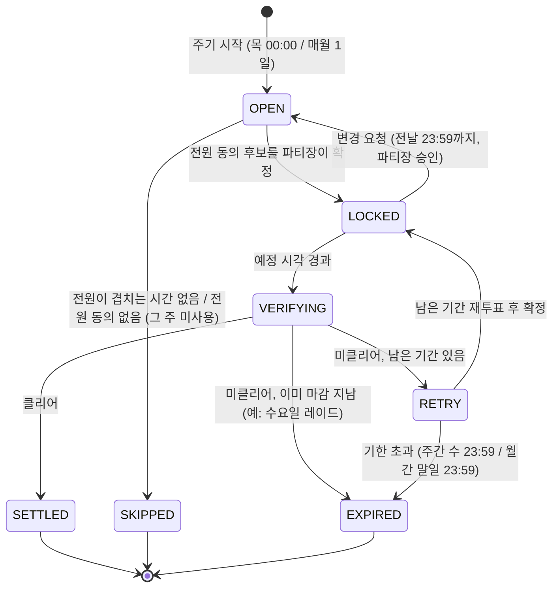
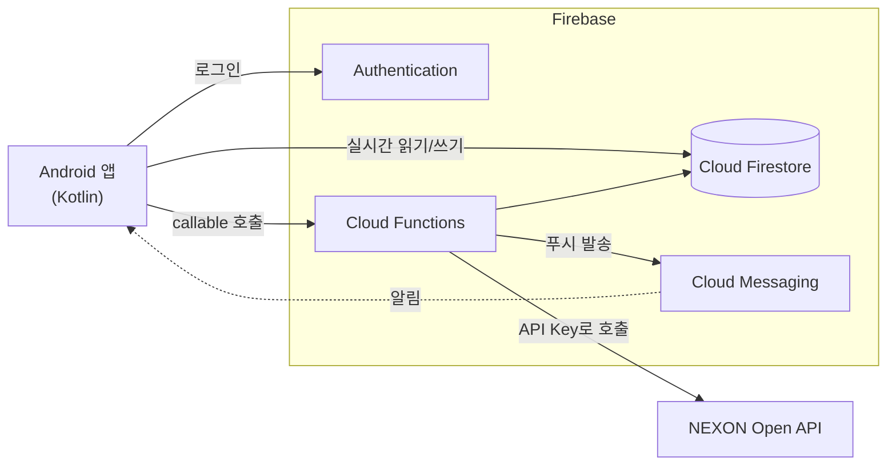

# 보스 스케줄 매니저

> 메이플스토리 고정 파티의 주간 보스 일정 조율부터 클리어 확인, 분배금 정산까지 한 앱에서 처리하는 Android 애플리케이션


파티를 한 번 등록해 두면, 파티원이 매주 할 일은 **불가능한 시간 체크와 투표**뿐입니다.

---

## 목차

- [배경](#배경)
- [주요 기능](#주요-기능)
- [동작 흐름](#동작-흐름)
- [시스템 구조](#시스템-구조)
- [기술 스택](#기술-스택)
- [NEXON Open API 사용](#nexon-open-api-사용)
- [핵심 규칙](#핵심-규칙)
- [데이터 구조](#데이터-구조)
- [Cloud Functions](#cloud-functions)
- [보안](#보안)
- [개발 일정](#개발-일정)
- [시작하기](#시작하기)
- [출처](#출처)

---

## 배경

메이플스토리의 주간 보스는 매주 목요일 00:00에 초기화됩니다. 같은 멤버로 매주 보스를 잡는 **고정 파티**는 그때마다 서로 가능한 시간을 다시 맞춰야 합니다.

지금은 이 조율을 이렇게 합니다.

| 방식 | 문제 |
| --- | --- |
| 단톡방에서 가능 시간 수기 비교 | 답을 모아 사람이 하나씩 비교해야 하고, 변경 사항을 찾으려면 대화를 거슬러 올라가야 함 |
| 공유 엑셀 시간표 + 수식 | 입력 형식이 다르거나 수식이 깨지면 잘못된 시간이 나옴 |
| 파티별로 따로 조율 | 한 사람이 여러 파티에 속해 있어 파티끼리 시간이 겹침 |

보스 스케줄 매니저는 여러 파티의 일정을 **충돌 없이** 한곳에서 조율하고, 클리어 확인과 분배금 정산까지 이어 줍니다.

## 주요 기능

- **불가 시간 체크:** 30분 단위 주간 시간표에서 안 되는 칸만 탭하고 **제출** (안 되는 시간이 없어도 제출)
- **추천 시간 계산:** 파티원 전원이 가능한 구간 중 보스 소요 시간 이상인 구간을 빠른 순 3개 추천. 다른 파티에서 이미 확정된 시간은 불가 시간과 똑같이 제외
- **그 주 미사용:** 전원이 겹치는 시간이 없으면 그 주기는 건너뜀(용병 사용 등)
- **동의 투표와 확정:** 전원이 동의한 후보 중에서 파티장이 최종 확정
- **파티 간 충돌 방지:** 같은 사용자가 속한 다른 파티 일정과 겹치면 확정 거절
- **미입력 경고:** 미입력 파티원에게 입력 요청, 파티장에게 "미입력 파티원이 존재합니다" 알림
- **일정 변경 요청:** 확정 후에도 레이드 전날 23:59까지 요청 가능, 파티장 승인 시 재투표
- **클리어 확인:** 예정 시간이 지나면 앱이 결과를 물어 클리어·미클리어를 직접 기록, 기록이 없으면 NEXON 스케줄러 API로 자동 확인
- **재조정:** 미클리어 시 잠가 둔 불가 시간으로 남은 기간 안에서 다시 추천
- **분배금 정산:** 1인 분배금 등록, 수령 방법 채팅, `대기 → 지급함 → 수령 확인` 상태 관리

## 동작 흐름

9단계를 4개 Phase로 나눴습니다.

| Phase | 단계 | 내용 |
| --- | --- | --- |
| **1. 온보딩·파티 매핑** (처음 1회) | 1–4 | 로그인 → API Key 등록·캐릭터 불러오기 → 캐릭터 선택 → 고정 파티 개설·초대 |
| **2. 주간 가용성·잠금** (매주 목요일 / 월간 보스는 매월 1일) | 5–7 | 시작 알림 → 불가 시간 입력 → 추천·동의 투표 → 파티장 확정 |
| **3. 클리어 확인** | 8-1 | 레이드 종료 후 앱에서 클리어·미클리어 직접 기록, 기록이 없으면 매일 05:00 API 확인 |
| **4. 사후 처리** | 8-2, 9 | 미클리어 시 재조정, 클리어 시 분배금 정산 |

### 일정 상태



## 시스템 구조



| 영역 | 담당 |
| --- | --- |
| **클라이언트** (Android 앱) | 로그인·API Key 입력, 불가 시간 체크·투표, 일정 변경 요청·승인, 주간 시간표, 클리어 기록, 정산 채팅 |
| **서버** (Cloud Functions, 서버리스) | 넥슨 API 호출 대행, 추천 시간 계산, 일정 확정, 변경 요청 마감 검사, 주기 시작 알림, 05시 클리어 확인 |
| **데이터** (Cloud Firestore) | 계정·캐릭터·파티, 불가 시간·투표·확정 일정, 클리어 기록, 정산 메시지, API 응답 캐시 |
| **외부 API** (NEXON Open API) | 캐릭터 목록·ocid, 캐릭터 기본 정보, 보스 클리어 여부 |

넥슨 API는 Cloud Functions에서만 호출하며, API Key와 캐릭터 식별자(ocid)는 앱에 저장하지 않습니다.

## 기술 스택

| 영역 | 기술 | 쓰임 |
| --- | --- | --- |
| 앱 | Kotlin, Jetpack Compose, Android Studio | 화면과 입력 |
| 인증 | Firebase Authentication | 이메일 회원가입·로그인 |
| DB | Cloud Firestore | 실시간 동기화, 트랜잭션, 보안 규칙 |
| 서버 | Cloud Functions (TypeScript) | callable 함수, 예약 실행, Firestore 트리거 |
| 알림 | Firebase Cloud Messaging | 시작·미입력·확정·변경·정산 알림 |
| 외부 API | NEXON Open API | 캐릭터 정보, 보스 클리어 여부 |
| 배포 | APK | 스토어 등록 없이 파티원에게 배포 |

## NEXON Open API 사용

| 단계 | 엔드포인트 | 사용 값 | 호출 시점 |
| --- | --- | --- | --- |
| 2 | `GET /maplestory/v1/character/list` | 계정의 캐릭터 목록, ocid | API Key 등록 시, 30일 안에 갱신 |
| 3 | `GET /maplestory/v1/character/basic` | 레벨, 직업, 이미지 | 캐릭터 선택 시 (캐시) |
| 8-1 | `GET /maplestory/v1/scheduler/character-state` | `boss_contents[].complete_flag` | 직접 기록이 없을 때 매일 05:00 |

- 호스트 `https://open.api.nexon.com`, 인증 헤더 `x-nxopen-api-key`, GET · JSON
- 본인 계정의 캐릭터만 조회할 수 있으므로 **파티원마다 자기 API Key를 등록**합니다.
- 게임 데이터는 평균 약 15분 뒤에 반영됩니다.
- 스케줄러 API의 `date`(KST `YYYY-MM-DD`)는 그 날짜 기준 상태를 돌려주며, **최근 약 7일**까지만 조회됩니다. 더 오래된 날짜나 미래 날짜는 `OPENAPI00004`(400)입니다.
- `boss_contents` 항목은 `content_name`(보스 이름), `difficulty`(`easy`·`normal`·`hard`·`chaos`·`extreme`), `cycle`(`bossDaily`·`bossWeekly`·`bossMonthly`), `complete_flag`(문자열 `"true"`·`"false"`)입니다. 파티의 보스 이름·난이도가 이 값과 같아야 자동 확인이 됩니다. 앱의 보스 목록은 이 응답에서 가져왔습니다.
- 위 세 엔드포인트의 응답 형식은 실제 API Key로 호출해 확인했습니다(2026-11).
- 개발 단계 호출 한도는 하루 1,000건입니다. 응답을 Firestore에 캐시해 중복 호출을 줄입니다.
- 재시도는 429, 5xx, 점검 중 코드에만 지수 백오프로 합니다.

## 핵심 규칙

**불가 시간 입력**
- 파티원은 불가 시간을 체크한 뒤 **제출** 버튼을 눌러야 입력한 것으로 봅니다. 안 되는 시간이 없어도 제출합니다.
- 입력 마감은 **주기 시작일 23:59**입니다(주간 보스는 목요일, 월간 보스는 1일).
- 마감까지 제출하지 않은 파티원에게는 입력 요청을, 파티장에게는 미입력자 알림을 보냅니다. 고정 파티라 따로 연락할 수 있으므로 미입력자를 자동으로 제외하지는 않습니다.

**추천 시간**
- 전원이 제출하면 전원이 가능한 구간 중 보스 소요 시간 이상인 구간을 빠른 순으로 3개 추천합니다. 이미 지난 시간은 추천하지 않습니다.
- 연속으로 비는 구간마다 앞에서부터 소요 시간만큼 겹치지 않게 자르고, 각 구간의 첫 번째 시간을 먼저 추천합니다. 붙어 있는 시간 3개가 아니라 서로 다른 시간대가 먼저 나오게 하기 위해서입니다.
- 누군가 불가 시간을 고쳐 다시 제출하거나 제출을 취소하면 추천과 투표는 처음부터 다시 진행합니다.
- 파티원이 속한 **다른 파티의 확정 시간(`busy`)은 불가 시간과 똑같이** 먼저 제외합니다. 확정 트랜잭션의 충돌 검사는 그 뒤의 최종 방어선입니다.
- 전원이 겹치는 구간이 하나도 없으면 그 주기는 **SKIPPED(그 주 미사용)**로 끝냅니다.
- 전원이 투표했는데 전원이 동의한 후보가 없으면 **다음 후보 3개**로 넘어갑니다. 더 줄 후보가 없으면 SKIPPED로 끝냅니다.

**일정 확정**
- 파티원은 추천 후보 3개마다 동의 여부를 투표합니다. 자기 투표만 쓸 수 있고 다른 사람의 투표는 바꿀 수 없습니다.
- 전원이 동의한 후보 중에서 파티장이 최종 확정합니다. 이미 지난 시간은 확정할 수 없습니다.
- 확정하는 순간 파티원 전원의 다른 파티 확정 시간과 겹치는지 다시 검사하고, 겹치면 누구의 일정과 겹치는지 알려 주며 거절합니다.

**파티 구성 변경**
- 가입, 탈퇴, 파티장 위임은 **주기 시작일(KST)에만** 할 수 있습니다. 주간 보스 파티는 목요일, 월간 보스 파티는 매월 1일입니다. 검사는 Cloud Functions에서 서버 시각으로 합니다.
- 가입과 탈퇴는 그날 중에서도 **이번 주기 일정이 확정되기 전**에만 할 수 있습니다. 가입·탈퇴가 있으면 추천과 투표를 다시 진행합니다.
- 예외: 아직 첫 주기가 시작되지 않은 **새 파티**는 요일과 상관없이 가입·탈퇴·위임할 수 있습니다. 주기 시작일에 만든 파티는 바로 그 주기 일정이 열리고, 다른 날에 만든 파티는 다음 주기 시작 때 첫 일정이 열립니다.
- 파티장은 다른 파티원에게 위임한 뒤에 탈퇴할 수 있습니다. 마지막 한 명이 탈퇴하면 파티가 삭제됩니다. 파티 정원은 6명입니다.

**일정 변경 요청**
- 확정(LOCKED) 후에도 **레이드 전날 23:59까지** 변경을 요청할 수 있습니다.
- 파티장이 승인하면 확정 시간을 해제하고 OPEN으로 돌아가 남은 기간 안에서 재투표합니다. 승인은 레이드 시작 전까지 할 수 있습니다.
- 승인되면 **요청한 사람은 불가 시간을 다시 제출**해야 새 추천이 나옵니다. 그대로 두면 같은 시간이 다시 추천되기 때문입니다.
- 처리 대기 중인 요청은 일정마다 하나만 둘 수 있습니다. 파티장은 거절할 수도 있습니다.
- 마감 검사는 기기 시계 조작으로 우회할 수 없도록 Cloud Functions에서 합니다.

**클리어 확인**
- 메이플스토리 보스는 파티 단위로 클리어됩니다. 따라서 결과는 클리어 / 미클리어 두 가지뿐입니다.
- 레이드 시작 시각이 지나면 앱이 파티원에게 결과를 묻고, **클리어 또는 미클리어**를 직접 기록하게 합니다. 시작 전에는 기록할 수 없습니다.
- 파티원 누구든 먼저 남긴 기록이 바로 반영됩니다. 클리어 기록은 즉시 SETTLED로, 미클리어 기록은 즉시 RETRY로 넘깁니다. 남은 기간이 없으면(예: 수요일 레이드) RETRY를 거치지 않고 EXPIRED가 됩니다.
- RETRY에서는 확정 시간을 풀고, 이전 불가 시간으로 남은 기간 안에서 바로 다시 추천합니다. 파티원은 불가 시간을 고쳐서 다시 제출할 수 있습니다. 이후 투표와 확정 절차는 처음과 같습니다.
- RETRY에서 더 잡을 수 있는 시간이 없으면 EXPIRED로 끝냅니다.
- 예정 시각이 지난 LOCKED 일정은 30분마다 도는 정리 함수가 VERIFYING으로 바꿉니다.
- 기록이 없으면 매일 05:00에 스케줄러 API로 확인합니다. 이때 `date`는 **레이드 날짜**로 지정합니다(목요일 초기화 이후에도 수요일 레이드를 올바르게 확인하기 위함).
- 파티원들의 API Key로 차례로 조회해 **한 명이라도 클리어로 나오면 클리어**, 확인된 사람이 모두 미클리어면 미클리어로 봅니다. 키 만료나 점검으로 아무도 확인하지 못하면 VERIFYING에 두고 다음 날 다시 확인하며, 주기가 끝나고 이틀이 지나도 확인하지 못하면 EXPIRED로 끝냅니다.
- 일정을 확정하지 못한 채 주기가 끝나면 OPEN은 SKIPPED로, RETRY는 EXPIRED로 끝냅니다.

**알림**

| 때 | 받는 사람 |
| --- | --- |
| 주기 시작 | 전원 |
| 입력 마감이 지났는데 미입력 (매일 00:00) | 미입력 파티원에게 입력 요청, 파티장에게 "미입력 파티원이 존재합니다" |
| 추천 시간이 나옴, 다음 후보로 넘어감 | 전원 |
| 전원이 동의한 후보가 생김 | 파티장 |
| 일정 확정 | 전원 |
| 변경 요청 / 승인 / 거절 | 파티장 / 전원 / 요청한 사람 |
| 예정 시각이 지나 결과 기록 필요 | 전원 |
| 클리어, 미클리어 재조정, 미사용·만료 | 전원 |
| 분배금 등록 | 받을 파티원 |
| 지급함 / 수령 확인 | 받는 사람 / 판매자 |
| 정산 완료 | 전원 |
| 정산 채팅 메시지 | 보낸 사람을 뺀 전원 |

알림을 누르면 해당 파티 화면이 열립니다. 로그아웃하면 그 기기의 토큰을 지워 알림이 가지 않습니다.

**주기와 마감**

| 보스 | 시작 | 마감 |
| --- | --- | --- |
| 주간 보스 | 매주 목요일 00:00 (KST) | 수요일 23:59 |
| 월간 보스 | 매월 1일 00:00 | 말일 23:59 |

**분배금 정산**
- 드롭 아이템을 판매한 파티원이 1인 분배금을 등록합니다(판매 금액은 넥슨 API에 없으므로 사용자 입력).
- 한 일정에는 **판매자 1명, 금액 1건**만 담습니다. 판매한 금액 전체를 인원수로 나누기 때문입니다.
- 클리어한 일정(SETTLED)에서 **먼저 등록한 파티원이 판매자**가 됩니다. 판매자는 아무에게도 지급하기 전까지 금액을 고쳐 다시 등록할 수 있습니다.
- 받을 파티원은 채팅으로 수령 방법을 전달합니다.
- 판매자 `지급함` → 받은 사람 `수령 확인`, 전원 수령 확인 시 정산 완료. 상태는 이 순서로만 바뀌며, 판매자가 `지급함`으로 표시하기 전에는 수령을 확인할 수 없습니다.
- 다음 주기가 시작된 뒤에도 끝나지 않은 지난 주기 정산은 파티 화면에서 계속 열 수 있습니다(최근 4개 주기).
- 확장 가능성: 경매장 수수료를 뺀 뒤 전원이 같은 금액을 받도록 계산하는 **분배금 계산**, 균등 분배가 아닌 **배율 조정**. 분배금을 파티원별 문서(`settlement/{uid}`)에 두는 것은 이 확장을 위한 구조입니다.

## 데이터 구조

```text
users/{uid}                      프로필, 선택한 캐릭터, API Key 등록 여부
  characters/{characterId}       캐릭터 기본 정보 캐시 (레벨, 직업, 이미지 / ocid 없음)
  devices/{token}                FCM 토큰이 문서 ID (본인만 접근)
  busy/{slotId}                  확정된 레이드 시간, 30분 칸마다 한 문서 (파티 간 충돌 검사, 내 시간표 표시)
secrets/{uid}                    API Key, ocid  ← 앱 접근 차단, Functions만 읽음
parties/{partyId}                보스, 난이도, 주기, 소요 시간, 파티장, 파티원 uid 목록·캐릭터, 6자리 초대 코드
  schedules/{periodId}           상태, 추천 후보, 후보 라운드, 전원 동의 후보, 확정 시각, 변경 요청, 분배금 요약
    unavailable/{uid}            파티원별 불가 시간 (30분 칸), 제출 여부
    votes/{uid}                  파티원별 동의 투표 (본인만 쓰기)
    clears/{uid}                 직접 기록한 클리어·미클리어
    settlement/{uid}             분배금, 대기·지급함·수령 확인 상태
    messages/{messageId}         정산 채팅
inviteCodes/{code}               초대 코드 → 파티 ID  ← 앱 접근 차단, joinParty만 읽음
```

**확정 트랜잭션:** 파티장이 확정하면 하나의 트랜잭션 안에서 ① 일정이 아직 OPEN인지, ② 파티원 전원의 `busy` 문서에 겹치는 시간이 없는지 확인한 뒤 LOCKED로 바꾸고 `busy`에 시간을 기록합니다. 같은 사용자가 속한 두 파티가 동시에 확정하면 나중 트랜잭션이 재실행되어 충돌로 거절됩니다. 충돌 단위는 캐릭터가 아니라 **사용자(uid)**입니다. `busy`의 `slotId`는 30분 칸마다 고정된 값(예: `20261112-2030`)이라, 같은 칸을 두 번 만들려는 시도가 문서 단위로 걸립니다.

**주기 ID와 시간 칸:** `periodId`는 주간이 `W-20261112`(시작 목요일), 월간이 `M-202611`입니다. 시간 칸 ID는 KST 기준 `yyyyMMdd-HHmm`(30분 단위)이고 `unavailable`의 `slots`와 `busy`의 문서 ID에 같이 씁니다.

**투표 라운드:** 일정의 `round`는 후보가 바뀔 때마다 1씩 오르고, 투표 문서는 자기가 투표한 `round`를 함께 저장합니다. 지난 라운드의 투표는 세지 않습니다.

**캐릭터 ID:** 앱은 캐릭터를 ocid 대신 ocid의 해시(`characterId`)로 가리킵니다. ocid는 `secrets/{uid}`에만 있습니다.

## Cloud Functions

| 종류 | 함수 | 역할 |
| --- | --- | --- |
| callable | `registerApiKey` | 키 유효성 확인, `secrets`에 저장, 캐릭터 목록 반환 |
| callable | `listCharacters` | 저장된 캐릭터 목록 반환, 30일이 지났으면 다시 받아 옴 |
| callable | `getCharacterInfo` | 캐릭터 기본 정보 조회·캐시 |
| callable | `createParty` | 파티 개설, 6자리 초대 코드 발급 |
| callable | `joinParty` / `leaveParty` / `delegateLeader` | 가입·탈퇴·파티장 위임 (주기 시작일에만 허용) |
| callable | `confirmSchedule` | 파티장 확정, 파티 간 충돌 검사 트랜잭션 |
| callable | `requestChange` / `approveChange` | 전날 23:59 마감 검사, 승인 시 확정 해제 |
| scheduled | `weeklyOpen` (목 00:00) | 주간 일정 생성, 시작 알림, 지난 RETRY 만료 처리 |
| scheduled | `monthlyOpen` (매월 1일 00:00) | 월간 일정 생성, 시작 알림, 지난달 RETRY 만료 처리 |
| scheduled | `dailyClearCheck` (05:00) | 기록 없는 일정 클리어 확인, 30일 지난 캐시 갱신 |
| scheduled | `scheduleSweep` (30분마다) | 예정 시각이 지난 일정을 VERIFYING으로, 주기가 끝난 미확정 일정을 종료로 |
| scheduled | `inputDeadlineCheck` (매일 00:00) | 입력 마감이 지난 일정의 미입력 경고 |
| trigger | `onUnavailableWrite` | 전원 제출 시 추천 후보 계산(다른 파티 확정 시간 제외), 겹치는 시간이 없으면 SKIPPED |
| trigger | `onVoteWrite` | 전원 동의 후보 갱신, 전원이 투표했는데 동의가 없으면 다음 후보 또는 SKIPPED |
| trigger | `onClearWrite` | 직접 기록한 클리어·미클리어 반영 (SETTLED / RETRY / EXPIRED) |
| callable | `registerSettlement` / `markPaid` / `confirmReceived` | 분배금 등록, 지급함, 수령 확인 |
| trigger | `onScheduleStateChange` | 시작·추천·확정·변경·클리어·재조정·분배금 등록·정산 완료 알림 |
| trigger | `onSettlementWrite` | 지급·수령 알림 |
| trigger | `onMessageCreate` | 정산 채팅 알림 |

모든 예약 함수는 `timeZone: "Asia/Seoul"`로 실행합니다. 위 함수는 모두 구현되어 있습니다. 전원 수령 확인 시의 정산 완료 처리는 트리거가 아니라 `confirmReceived` 안에서 합니다.

## 보안

- API Key와 ocid는 `secrets` 컬렉션에만 저장하고, Firestore 보안 규칙으로 클라이언트 접근을 막습니다.
- 넥슨 API 호출은 Cloud Functions에서만 합니다. 키와 ocid를 로그·URL·화면에 남기지 않습니다.
- 파티·일정 문서는 해당 파티원만 읽을 수 있습니다. 파티 구성, 일정 상태, 추천 후보, 확정 시각, 정산 상태는 Cloud Functions만 씁니다.
- 클라이언트가 직접 쓰는 것은 자기 프로필, 자기 불가 시간, 자기 투표, 자기 클리어 기록, 채팅뿐입니다.
- 마감 시각, 파티장 권한 같은 검사는 서버에서 합니다.

## 개발 일정

| 주차 | Phase | 할 일 |
| --- | --- | --- |
| 1주차 | 기반 구축 | Firebase 연결, 로그인, API Key 등록, 캐릭터 불러오기·선택 |
| 2주차 | 파티와 투표 | 고정 파티 개설·초대, 불가 시간 체크, 추천 시간 계산, 투표 |
| 3주차 | 확정과 확인 | 일정 확정·시간표, 변경 요청, 스케줄러 API 확인, 05시 예약 실행, RETRY 재조정 |
| 4주차 | 정산과 마무리 | 분배금 등록·채팅, 지급·수령 확인, FCM 알림, APK 빌드 |

네 Phase 모두 코드 구현을 마쳤습니다. 서버 로직은 단위 테스트와 Firestore 에뮬레이터 테스트로 확인했고, 앱은 빌드까지 확인했습니다. 남은 것은 실제 Firebase 프로젝트 배포와 기기에서의 동작 확인입니다.

- [x] Phase 1 · 온보딩 (구현)
- [x] Phase 2 · 주간 스케줄링 (구현)
- [x] Phase 3 · 클리어 확인 (구현)
- [x] Phase 4 · 사후 처리·정산 (구현)
- [ ] 실제 Firebase 프로젝트에 배포해 트리거·예약 함수·푸시 알림 확인
- [ ] 기기에서 전체 흐름 확인

## 시작하기

> 개발 중인 프로젝트입니다. 아래는 로컬 실행을 위한 준비 단계입니다.

**요구 사항**
- Android Studio (최신 안정 버전), JDK 17
- Node.js 22 (Firebase CLI는 `functions`의 개발 의존성에 포함)
- Firebase 프로젝트 (Cloud Functions 사용을 위해 Blaze 요금제)
- [NEXON Open API](https://openapi.nexon.com) 개발자 API Key

**설정**
1. 저장소를 클론합니다.
2. Firebase 콘솔에서 Android 앱을 등록하고 `google-services.json`을 `app/`에 넣습니다.
3. Authentication(이메일), Firestore, Cloud Messaging을 활성화합니다. Firestore 위치는 Functions와 같은 `asia-northeast3`(서울)로 만듭니다.
4. Functions와 보안 규칙, 인덱스를 배포합니다.
   ```bash
   cd functions
   npm install
   npx firebase login
   npx firebase deploy --project <프로젝트 ID> --only functions,firestore
   ```
5. Android Studio에서 앱을 빌드해 실행하고, 앱 안에서 본인의 NEXON API Key를 등록합니다.

> `google-services.json`과 API Key는 저장소에 커밋하지 마세요.

**APK 만들기**

```bash
./gradlew assembleDebug
```

`app/build/outputs/apk/debug/app-debug.apk`가 만들어집니다. 이 파일을 파티원에게 보내 설치하면 됩니다(기기에서 "출처를 알 수 없는 앱 설치" 허용 필요). 디버그 키로 서명된 APK라 스토어에는 올릴 수 없고, 빌드한 컴퓨터가 바뀌면 서명이 달라져 기존 앱 위에 덮어 설치되지 않습니다. 계속 배포하려면 한 컴퓨터에서 빌드하거나 릴리스 서명 키를 따로 만들어 쓰세요.

**폴더 구조**

```text
app/                 Android 앱 (Kotlin, Jetpack Compose)
functions/           Cloud Functions (TypeScript)
  src/nexon/         NEXON Open API 클라이언트 (재시도, 에러 분류)
  src/domain/        주기·시간 칸 계산, 추천 알고리즘 (순수 함수)
  src/party/         파티 개설·가입·탈퇴·위임
  src/schedule/      일정 생성, 추천·투표 판정
  src/settlement/    분배금 등록, 지급·수령 확인
  src/notify/        알림 문구 규칙 (순수 함수), FCM 발송
  src/callable/      callable 함수
  src/triggers.ts    Firestore 트리거, 예약 함수
  test/unit/         단위 테스트
  test/rules/        Firestore 보안 규칙 테스트 (에뮬레이터)
  test/emulator/     파티·일정·정산·알림 통합 테스트 (에뮬레이터)
firestore.rules      Firestore 보안 규칙
```

**테스트**

```bash
cd functions
npm test               # 단위 테스트
npm run test:emulator  # 보안 규칙·통합 테스트 (Firestore 에뮬레이터, Java 필요)
```

## 출처

Data based on NEXON Open API.

이 프로젝트는 넥슨과 무관한 개인 학습용 프로젝트이며, 메이플스토리 관련 명칭과 데이터의 권리는 NEXON Korea에 있습니다.
