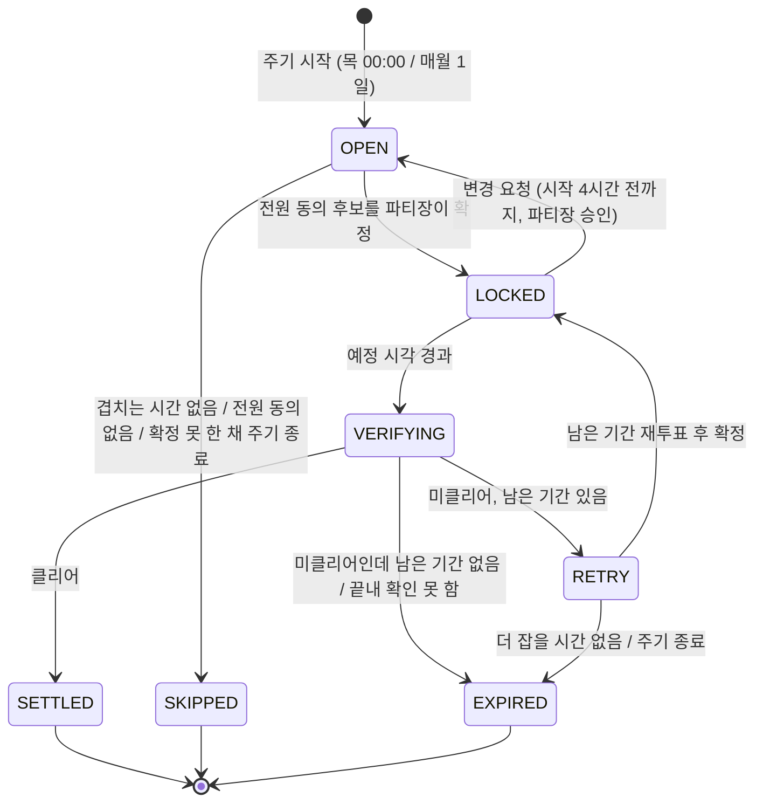
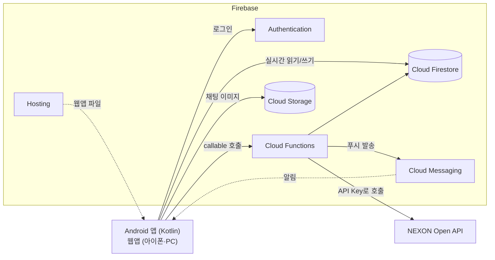

# 보스 스케줄 매니저

> 메이플스토리 고정 파티의 주간 보스 일정 조율부터 클리어 확인, 분배금 정산, 캐릭터별 보스 수익까지 한곳에서 처리하는 Android 앱과 웹앱(아이폰·PC)


파티를 한 번 등록해 두면, 파티원이 매주 할 일은 **불가능한 시간 체크와 투표**뿐입니다.

Android는 [릴리스 페이지](https://github.com/JHK0826/boss_planner/releases/latest)에서 최신 APK를 받아 설치하고, 아이폰·PC는 웹앱을 씁니다([앱 설치](#앱-설치-파티원)). 두 앱은 같은 계정·파티·일정을 써서 함께 쓸 수 있습니다. 버전별 변경 내용은 [CHANGELOG.md](CHANGELOG.md)에 있습니다.

---

## 목차

- [배경](#배경)
- [주요 기능](#주요-기능)
- [동작 흐름](#동작-흐름)
- [시스템 구조](#시스템-구조)
- [기술 스택](#기술-스택)
- [NEXON Open API 사용](#nexon-open-api-사용)
- [핵심 규칙](#핵심-규칙)
- [데이터 구조](#데이터-구조)
- [Cloud Functions](#cloud-functions)
- [보안](#보안)
- [개발 현황](#개발-현황)
- [시작하기](#시작하기)
- [버전 관리](#버전-관리)
- [출처](#출처)

---

## 배경

메이플스토리의 주간 보스는 매주 목요일 00:00에 초기화됩니다. 같은 멤버로 매주 보스를 잡는 **고정 파티**는 그때마다 서로 가능한 시간을 다시 맞춰야 합니다.

지금은 이 조율을 이렇게 합니다.

| 방식 | 문제 |
| --- | --- |
| 단톡방에서 가능 시간 수기 비교 | 답을 모아 사람이 하나씩 비교해야 하고, 변경 사항을 찾으려면 대화를 거슬러 올라가야 함 |
| 공유 엑셀 시간표 + 수식 | 입력 형식이 다르거나 수식이 깨지면 잘못된 시간이 나옴 |
| 파티별로 따로 조율 | 한 사람이 여러 파티에 속해 있어 파티끼리 시간이 겹침 |

보스 스케줄 매니저는 여러 파티의 일정을 **충돌 없이** 한곳에서 조율하고, 클리어 확인과 분배금 정산까지 이어 줍니다.

## 주요 기능

- **보스 묶음 파티:** 한 파티에 여러 보스를 묶어 한 번에 일정 조율 (예: 하드 발드릭스 + 하드 벨로나)
- **불가 시간 체크:** 30분 단위 시간표에 안 되는 시간을 표시하고 **제출** (안 되는 시간이 없어도 제출). 범위로 한 번에 채우기, 매주 반복되는 고정 불가 시간, 내 다른 파티에 함께 제출을 지원
- **추천 시간 계산:** 파티원 전원이 가능한 시각을 요일을 고르게 섞어 최대 6개 추천. 파티 선호 시간대와 내 다른 레이드 앞뒤(투표 중인 다른 파티 후보 앞뒤 포함)를 우선하고, 다른 파티에서 확정된 시간은 불가 시간과 똑같이 제외
- **그 주 미사용:** 전원이 겹치는 시간이 없으면 그 주기는 건너뜀(용병 사용 등)
- **다음 주 미리 조율:** 주간 파티는 이번 주 레이드가 끝나면 다음 주 일정이 바로 열려, 불가 시간 입력과 투표를 목요일 전에 미리 할 수 있음(확정은 목요일부터)
- **이번 주기 용병:** 못 가는 파티원은 그 주기만 용병으로 대체(입력·투표에서 빠짐), 파티장은 임시 용병을 추가. 용병은 계정 없는 더미로 분배금 1인분을 받음
- **동의 투표와 확정:** 전원이 동의한 후보 중에서 파티장이 최종 확정
- **파티 간 충돌 방지:** 같은 사용자가 속한 다른 파티 일정과 겹치면 확정 거절
- **미입력 경고:** 미입력 파티원에게 입력 요청, 파티장에게 "미입력 파티원이 존재합니다" 알림
- **일정 변경 요청:** 확정 후에도 레이드 시작 4시간 전까지 요청 가능, 파티장 승인 시 재투표
- **클리어 확인:** 레이드가 시작된 뒤 앱이 결과를 물어 클리어·미클리어를 직접 기록, 기록이 없으면 NEXON 스케줄러 API로 자동 확인
- **재조정:** 미클리어 시 이전 불가 시간을 그대로 써서 남은 기간 안에서 다시 추천
- **분배금 정산:** 경매장 판매액과 수수료로 파티원 정산금 계산, 상세 비율 설정, 수령 방법 채팅(이미지 첨부), `대기 → 지급함 → 수령 확인` 상태 관리. 끝난 정산도 최근 4개 주기까지 다시 볼 수 있음
- **내가 할 일:** 파티 목록에 파티마다 지금 해야 할 일(입력, 투표, 확정, 결과 기록, 정산 등)을 표시하고, 파티 화면의 탭에도 점으로 표시
- **보스 스케줄러와 수익:** 내 캐릭터 탭에 게임 스케줄러에 등록한 주간·월간 보스를 보스 이미지 칩으로, 클리어 여부와 함께 표시하고, 앱의 파티 인원수로 결정석 몫을 나눠 이번 주 예상 수익, 이번 주에 번 돈(결정석 + 정산금), 월별 수익을 보여 줌
- **푸시 알림:** 주기 시작, 추천, 확정, 변경 요청, 결과 기록, 정산 단계마다 알림. 웹앱은 웹 푸시(아이폰은 홈 화면에 추가한 앱에서)
- **아이폰·PC 웹앱:** Android 앱과 같은 기능을 웹앱(PWA)으로도 제공. 같은 계정·파티를 써서 Android 파티원과 함께 쓸 수 있음

## 동작 흐름

9단계를 4개 Phase로 나눴습니다.

| Phase | 단계 | 내용 |
| --- | --- | --- |
| **1. 온보딩·파티 매핑** (처음 1회) | 1–4 | 로그인 → API Key 등록·캐릭터 불러오기 → 캐릭터 선택 → 고정 파티 개설·초대 |
| **2. 주간 가용성·잠금** (매주 목요일 / 월간 보스는 매월 1일) | 5–7 | 시작 알림 → 불가 시간 입력 → 추천·동의 투표 → 파티장 확정 |
| **3. 클리어 확인** | 8-1 | 레이드 시작 후 앱에서 클리어·미클리어 직접 기록, 기록이 없으면 매일 05:00 API 확인 |
| **4. 사후 처리** | 8-2, 9 | 미클리어 시 재조정, 클리어 시 분배금 정산 |

### 일정 상태

일정은 파티마다 주기(주간 또는 월간)에 하나씩 만들어지고, 아래 상태를 거칩니다.



| 상태 | 뜻 |
| --- | --- |
| `OPEN` | 불가 시간 입력, 추천, 투표를 받는 중 |
| `LOCKED` | 레이드 시간이 확정됨 |
| `VERIFYING` | 예정 시각이 지나 결과(클리어 여부)를 기다리는 중 |
| `SETTLED` | 클리어. 분배금 정산 단계 |
| `RETRY` | 미클리어라 남은 기간에서 다시 조율하는 중. 절차는 `OPEN`과 같음 |
| `SKIPPED` | 이번 주기는 진행하지 않음 (그 주 미사용) |
| `EXPIRED` | 클리어하지 못하고 주기가 끝남 |

레이드가 시작된 뒤에는 `LOCKED` 상태에서도 바로 결과를 기록할 수 있습니다. 이때는 `VERIFYING`을 거치지 않고 `SETTLED`, `RETRY`, `EXPIRED`로 넘어갑니다.

### 앱 화면

하단 메뉴 네 개로 나뉩니다.

| 메뉴 | 내용 |
| --- | --- |
| 내 캐릭터 | 골라 둔 캐릭터마다 게임 스케줄러에 등록한 주간·월간 보스(보스 이미지, 클리어 체크, 난이도, 앱 파티 인원수), 수익 보기, 캐릭터 다시 선택 |
| 파티 | 내 파티 목록(파티마다 내가 할 일과 그 파티에 들어간 내 캐릭터 표시), 캐릭터별로 보기, 정렬(할 일 먼저·캐릭터순·파티 이름순·최근 가입순), 파티 만들기, 초대 코드로 가입. 파티를 누르면 파티 화면(아래)으로 들어감 |
| 시간표 | 고정 불가 시간 설정, 확정된 일정 목록, 이번 주(목~수) 시간표 |
| 설정 | 다크 모드(처음에는 휴대폰 설정을 따르고, 바꾸면 기기에 저장), API Key 다시 등록, 로그아웃, 앱 버전. 웹앱은 알림 켜기·끄기도 여기서 함 |

**내 캐릭터 탭과 수익 보기**

캐릭터마다 게임 스케줄러에 등록한 주간·월간 보스를 칩으로 보여 줍니다(일간 보스 제외). 칩에는 보스 이름, 클리어 체크, 난이도 배지(`EX`·`C`·`H`·`N`·`E`)가 있고, 그 캐릭터로 그 보스를 가는 파티가 앱에 있으면 파티 인원을 붙입니다(예: 3인 림보 파티면 `H/3`). 위의 "새로고침"으로 다시 받습니다.

캐릭터 옆 "수익 보기"를 누르면 이번 주 예상 수익, 이번 주에 번 돈(결정석과 정산금, 정산금은 파티별), 최근 6개월 월별 수익을 보여 줍니다. 계산 방식은 [보스 스케줄러와 수익](#보스-스케줄러와-수익)에 있습니다.

**파티 화면**

파티를 누르면 파티 화면이 열리고, 하단 탭 네 개로 나뉩니다.

| 탭 | 내용 |
| --- | --- |
| 파티 | 보스·주기·소요 시간, 초대 코드(복사·공유), 파티원 목록(진행 상태 표시). 파티원마다 "시간표 보기"를 누르면 그 사람이 이번 주기에 제출한 불가 시간을 시간표로 봄 |
| 투표 | 이번 주기 일정: 불가 시간 입력·수정, 추천 후보 투표(요일별, 모두 가능), 확정, 변경 요청·승인·거절, 클리어·미클리어 기록. 파티장은 "이번 주기 지금 시작" |
| 정산 | 클리어한 일정의 분배금 등록·지급·수령 확인과 정산 채팅. 최근 5개 주기 중 클리어한 주기가 여러 개면 위에서 주기를 고름(정산이 끝난 주기도 "정산 완료"로 남아 내역을 다시 볼 수 있음) |
| 설정 | 추천 설정(선호 시간대·최소 여유 시간, 파티장만 바꿈), 파티장 위임(파티장), 파티 탈퇴 |

투표 탭과 정산 탭에는 그 탭에서 내가 할 일이 있으면 점이 붙습니다. 파티 화면을 열면 할 일이 있는 탭(투표 → 정산)부터, 없으면 파티 탭부터 보여 줍니다. 알림을 눌러 들어와도 같습니다.

**내가 할 일**

파티 목록의 각 파티에는 지금 내가 해야 할 일이 표시됩니다. 여러 개면 급한 것 하나와 나머지 건수를 보여 줍니다.

| 할 일 | 언제 |
| --- | --- |
| 결과 기록 | 확정된 레이드가 시작된 뒤 |
| 변경 요청 처리 | 파티원이 일정 변경을 요청했을 때 (파티장) |
| 불가 시간 입력 | 이번 주기 불가 시간을 아직 제출하지 않았을 때 |
| 투표 | 추천 후보가 나왔는데 아직 투표하지 않았을 때 |
| 일정 확정 | 전원이 동의한 후보가 있을 때 (파티장) |
| 정산금 지급 | 분배금을 등록했고 아직 지급하지 않은 파티원이 있을 때 (판매자) |
| 정산금 수령 확인 | 판매자가 지급함으로 표시했을 때 |

할 일이 없으면 "다른 파티원 입력 대기 (2/4)", "확정 11/14(토) 21:00"처럼 지금 상황을 보여 줍니다. 하단 메뉴의 파티 아이콘에는 할 일이 있는 파티 수가 붙습니다.

할 일을 알려면 파티마다 최근 일정을 지켜봐야 해서, 읽기를 줄이도록 이렇게 동작합니다.

- 파티 탭을 보고 있고 앱이 화면에 떠 있을 때만 지켜봅니다. 다른 화면에 있는 동안은 마지막으로 읽은 값을 쓰고, 파티 탭에 돌아오면 새로 맞춥니다.
- 파티마다 이번 주기와 바로 전 주기 일정 두 개만 읽습니다. 그보다 오래된 주기의 끝나지 않은 정산은 목록의 할 일에는 나오지 않고, 파티 화면의 정산 탭에서 볼 수 있습니다(최근 4개 주기).
- 불가 시간·투표·분배금 상태는 입력 중, 투표 중, 정산 중일 때만 지켜보고, 지켜볼 대상이 바뀔 때만 다시 구독합니다.

## 시스템 구조



| 영역 | 담당 |
| --- | --- |
| **클라이언트** (Android 앱, 웹앱) | 로그인·API Key 입력, 파티 만들기·가입, 불가 시간 체크·투표, 일정 변경 요청·승인, 이번 주 시간표, 클리어 기록, 정산·채팅, 내 캐릭터 보스·수익 보기 |
| **서버** (Cloud Functions, 서버리스) | NEXON API 호출 대행, 파티 구성 검사, 추천 시간 계산, 일정 확정, 변경 요청 마감 검사, 05시 클리어 확인, 정산 상태 관리, 게임 스케줄러 조회·수익 기록, NEXON 데이터 30일 갱신, 알림 발송 |
| **데이터** (Cloud Firestore) | 계정·캐릭터·파티, 불가 시간·투표·확정 일정, 클리어 기록, 분배금·정산 채팅, 수익 기록, API 응답 캐시 |
| **파일·배포** (Cloud Storage, Hosting) | 정산 채팅 첨부 이미지, 웹앱 배포 |
| **외부 API** (NEXON Open API) | 캐릭터 목록·ocid, 캐릭터 기본 정보, 게임 스케줄러에 등록한 보스와 클리어 여부 |

NEXON API는 Cloud Functions에서만 호출하며, API Key와 캐릭터 식별자(ocid)는 앱에 저장하지 않습니다.

## 기술 스택

| 영역 | 기술 | 쓰임 |
| --- | --- | --- |
| 앱 | Kotlin, Jetpack Compose, Android Studio | 화면과 입력 |
| 웹앱 | React, TypeScript, Vite, PWA | 아이폰·PC용. Android 앱과 같은 서버·데이터 |
| 인증 | Firebase Authentication | 이메일 회원가입·로그인 |
| DB | Cloud Firestore | 실시간 동기화, 트랜잭션, 보안 규칙 |
| 서버 | Cloud Functions (TypeScript, Node.js 22) | callable 함수, 예약 실행, Firestore 트리거 |
| 파일 | Cloud Storage for Firebase | 정산 채팅 첨부 이미지 |
| 알림 | Firebase Cloud Messaging | 시작·미입력·확정·변경·정산 알림 (Android 알림, 웹 푸시) |
| 외부 API | NEXON Open API | 캐릭터 정보, 보스 클리어 여부, 게임 스케줄러에 등록한 보스 |
| 배포 | GitHub 릴리스의 서명한 APK, Firebase Hosting | 스토어 등록 없이 파티원에게 배포 (웹앱은 주소로 접속) |
| 릴리스 | GitHub Actions | 버전이 바뀌면 태그·릴리스 생성, APK 빌드·첨부 |
| 테스트 | Vitest, Firebase 에뮬레이터, Playwright, JUnit | 서버 단위·통합 테스트, 보안 규칙 테스트, 웹 E2E, 앱 단위 테스트 |

## NEXON Open API 사용

| 단계 | 엔드포인트 | 사용 값 | 호출 시점 |
| --- | --- | --- | --- |
| 2 | `GET /maplestory/v1/character/list` | 계정의 캐릭터 목록, ocid | API Key 등록 시, 25일이 지나면 갱신 |
| 3 | `GET /maplestory/v1/character/basic` | 레벨, 직업, 이미지 | 캐릭터 선택 시 (24시간 캐시), 25일이 지나면 갱신 |
| 8-1 | `GET /maplestory/v1/scheduler/character-state` | `boss_contents[].complete_flag` | 직접 기록이 없을 때 매일 05:00 |
| 내 캐릭터 탭 | `GET /maplestory/v1/scheduler/character-state` | `registration_flag`, `complete_flag` | 내 캐릭터 탭을 열 때 (10분 캐시), 목요일·1일 05:00에 끝난 주·달 확정 |

- 호스트 `https://open.api.nexon.com`, 인증 헤더 `x-nxopen-api-key`, GET · JSON
- 본인 계정의 캐릭터만 조회할 수 있으므로 **파티원마다 자기 API Key를 등록**합니다.
- 게임 데이터는 평균 약 15분 뒤에 반영됩니다. 자동 확인은 레이드가 끝나고 30분이 지난 일정만 조회합니다.
- 스케줄러 API의 `date`(KST `YYYY-MM-DD`)는 그 날짜 기준 상태를 돌려주며, **최근 약 7일**까지만 조회됩니다. 더 오래된 날짜, 오늘, 미래 날짜는 `OPENAPI00004`(400)입니다. 오늘 상태는 `date`를 빼고 조회합니다.
- `boss_contents` 항목은 `content_name`(보스 이름), `difficulty`(`easy`·`normal`·`hard`·`chaos`·`extreme`), `cycle`(`bossDaily`·`bossWeekly`·`bossMonthly`), `registration_flag`(게임 스케줄러에 등록했는가), `complete_flag`(문자열 `"true"`·`"false"`)입니다. 파티의 보스 이름·난이도가 이 값과 같아야 자동 확인이 됩니다. 서버의 보스 목록은 이 응답에서 가져왔습니다(일간 보스와 시즌 보스 제외).
- 세 엔드포인트(`character/list`, `character/basic`, `scheduler/character-state`)의 응답 형식은 실제 API Key로 호출해 확인했습니다(2026-11).
- 개발 단계 호출 한도는 하루 1,000건입니다. 응답을 Firestore에 캐시해 중복 호출을 줄입니다.
- 재시도는 429, 5xx, 점검 중 코드에만 지수 백오프로 합니다.
- **데이터 갱신 의무**: API로 받아 저장한 데이터는 30일 안에 다시 받아야 합니다. 캐릭터 목록(`secrets/{uid}`)과 캐릭터 기본 정보 캐시(`users/{uid}/characters`)는 받은 지 25일이 지나면 매일 05:00 작업이 다시 받고, 파티에 옮겨 적은 캐릭터 이름·직업·레벨도 함께 맞춥니다. 키가 만료됐거나 계정에서 빠진 캐릭터처럼 다시 받을 수 없는 캐시는 지웁니다. 스케줄러 캐시(`users/{uid}/scheduler`)는 25일이 지나면 지웁니다. 수익 기록(`users/{uid}/earnings`)에는 보스 목록 원본 없이 합계만 남깁니다.
- **출처 표기**: 앱과 웹앱의 내 캐릭터 화면과 설정 화면에 "Data based on NEXON Open API"를 표시합니다.

## 핵심 규칙

### 주기와 마감

| 보스 | 주기 시작 | 주기 끝 | 불가 시간 입력 마감 | 파티 구성 변경 가능일 |
| --- | --- | --- | --- | --- |
| 주간 보스 | 매주 목요일 00:00 | 수요일 23:59 | 목요일 23:59 | 목요일 |
| 월간 보스 | 매월 1일 00:00 | 말일 23:59 | 1일 23:59 | 매월 1일 |

모든 시각은 한국 시간(KST)이고, 날짜와 마감 검사는 기기 시계가 아니라 서버 시각으로 합니다.

주간 파티는 이번 주 레이드가 끝나면 다음 주 일정을 미리 엽니다([다음 주 미리 조율](#다음-주-미리-조율)). 입력 마감은 똑같이 다음 주 목요일 23:59입니다.

### 파티와 보스

- 한 파티에 보스를 여러 개(최대 12개) 묶을 수 있습니다. 보스마다 난이도를 따로 고릅니다.
- 주간 보스와 월간 보스(검은 마법사)는 주기가 달라 한 파티에 섞을 수 없습니다. 주기는 고른 보스에 따라 서버가 정합니다.
- **같은 캐릭터는 같은 보스를 두 파티에서 잡을 수 없습니다.** 난이도가 달라도 같은 보스로 봅니다. 예를 들어 하드 발드릭스 + 벨로나 묶음 파티에 넣은 캐릭터로는 발드릭스나 벨로나가 들어간 파티를 또 만들거나 가입할 수 없습니다. 다른 캐릭터로는 가능합니다.
- 보스 목록은 서버(`functions/src/domain/bosses.ts`)가 갖고 있고 앱은 `getBossCatalog`로 받아 씁니다. 새 보스가 나오면 이 파일만 고쳐 Functions를 배포하면 되고, 앱은 다시 설치하지 않아도 됩니다.
- **시즌 보스는 솔로 전용이라 목록에 넣지 않습니다.**
- 파티 정원은 6명입니다.

### 소요 시간

- 보스 하나에 20분으로 계산해 묶은 보스 수만큼 자동으로 잡고, 10분 단위로 고칠 수 있습니다(20분~4시간).
- 불가 시간표와 파티 간 충돌 검사는 30분 칸 단위입니다. 추천 시간은 정각이나 30분에 시작하고, 끝나는 시각은 실제 소요 시간으로 잡습니다(40분이면 20:00~20:40). 충돌 검사에서는 그 시간이 걸친 30분 칸 전체(20:00~21:00)를 잡힌 것으로 봅니다.

### 파티 구성 변경

- 가입, 탈퇴, 파티장 위임은 **주기 시작일에만** 할 수 있습니다.
- 가입과 탈퇴는 그날 중에서도 **이번 주기 일정이 확정되기 전**에만 할 수 있습니다. 가입·탈퇴가 있으면 추천과 투표를 다시 진행합니다.
- 예외: 아직 첫 일정이 열리지 않은 **새 파티**는 요일과 상관없이 가입·탈퇴·위임할 수 있습니다.
- **파티를 만든 주기에는 일정이 자동으로 열리지 않습니다.** 주기 시작일(목요일·1일)에 만들어도 마찬가지입니다. 파티장이 "이번 주기 지금 시작"을 눌러야 열리고, 누르지 않으면 다음 주기 시작 때 자동으로 열립니다. 파티원을 다 모으기 전에 일정이 열려 가입이 막히는 일을 막기 위해서입니다.
- **이번 주기 지금 시작:** 파티장이 파티 화면의 투표 탭에서 이번 주기 일정을 바로 열 수 있습니다. 남은 기간(주간은 다음 수요일까지) 안에서 조율하고, 불가 시간 입력 마감은 시작한 날 23:59입니다. 일정이 열린 뒤에는 가입·탈퇴가 다시 주기 시작일로 제한되므로 파티원을 다 모은 뒤에 시작합니다. 소요 시간만큼의 시간도 남지 않았으면 시작할 수 없습니다.
- 파티장은 다른 파티원에게 위임한 뒤에 탈퇴할 수 있습니다. 마지막 한 명이 탈퇴하면 파티가 삭제됩니다. 위임과 탈퇴는 파티 화면의 설정 탭에서 합니다.

### 불가 시간 입력

- 파티원은 불가 시간을 체크한 뒤 **제출** 버튼을 눌러야 입력한 것으로 봅니다. 안 되는 시간이 없어도 제출합니다.
- 입력 마감은 **주기 시작일 23:59**입니다. 파티장이 주기 중간에 일정을 연 경우에는 연 날 23:59입니다.
- 한 칸씩 누르지 않아도 되도록 세 가지를 지원합니다.
  - **한 번에 채우기:** 요일(매일·평일·주말·요일별)과 시간대를 골라 그 범위를 통째로 불가 또는 가능으로 바꿉니다. 날짜를 누르면 하루 전체가, 왼쪽의 시각을 누르면 그 시각의 모든 날이 바뀝니다. 되는 시간이 더 적다면 "전체 불가"를 누른 뒤 되는 시간대만 비우는 편이 빠릅니다.
  - **고정 불가 시간:** 출근·수면처럼 매주 반복되는 시간을 시간표 메뉴에서 한 번 저장해 두면, 새 주기의 시간표가 그 값으로 미리 채워집니다. 달라진 부분만 고치고 제출하면 됩니다. 미리 채워질 뿐 자동으로 제출되지는 않습니다.
  - **내 다른 파티에도 제출:** 불가 시간은 캐릭터가 아니라 사람 기준이므로, 제출할 때 같은 주기에 입력을 받는 내 다른 파티에도 같은 시간으로 함께 제출합니다(체크를 풀 수 있음). 주기가 다른 파티(주간 ↔ 월간)와 이미 확정된 파티는 건너뜁니다.
- 마감이 지나도 제출하지 않은 파티원에게는 입력 요청을, 파티장에게는 미입력자 알림을 매일 00:00에 보냅니다. 고정 파티라 따로 연락할 수 있으므로 미입력자를 자동으로 제외하지는 않습니다. 마감 뒤에도 제출은 받습니다.

### 추천 시간

전원이 제출하면 서버가 후보를 계산합니다(`functions/src/domain/recommend.ts`).

**가능한 시각**

- 전원이 소요 시간 내내 비어 있는 시각만 후보가 됩니다. 정각이나 30분에 시작합니다.
- 파티원이 속한 **다른 파티의 확정 시간(`busy`)은 불가 시간과 똑같이** 먼저 제외합니다. 확정 트랜잭션의 충돌 검사는 그 뒤의 최종 방어선입니다.
- 이미 지난 시간과 **최소 여유 시간** 안쪽은 추천하지 않습니다. 추천을 계산하는 시점으로부터 정한 시간(기본 3시간) 안에 시작하는 시각이 여기에 해당합니다. 그러면 남는 시각이 없을 때(주기 막바지 등)에는 여유 시간 없이 다시 찾습니다.

**우선순위**

시각마다 점수를 매겨 높은 것부터 고릅니다. 영향이 큰 순서입니다.

| 조건 | 효과 |
| --- | --- |
| **파티 선호 시간대** 안에 온전히 들어감 | 가장 먼저 추천 |
| 파티원이 겹치는 **다른 파티가 투표 중인 후보**와 겹침 | 뒤로 미룸. 두 파티가 같은 시간을 추천받아 한쪽이 확정 때 거절당하는 일을 줄임 |
| 파티원의 **다른 확정 레이드 바로 앞이나 뒤** | 우선. 한 번 접속했을 때 몰아서 돌 수 있음. **같은 캐릭터**로 잡힌 레이드면 캐릭터를 바꾸지 않아도 되어 더 우선 (붙는 파티원이 많을수록 더 우선) |
| 파티원이 겹치는 **다른 파티가 투표 중인 후보 바로 앞이나 뒤** | 조금 우선(확정 레이드보다는 덜). 그 파티 후보는 보통 요일마다 하나씩이라, 어느 후보로 확정되든 이어서 돌 시각이 남음. 같은 캐릭터면 더 우선 |
| 정각에 시작 | 30분에 시작하는 시각보다 우선 |
| 주기 앞쪽 날짜 | 조금 우선. 미클리어 때 다시 잡을 여유가 남음 |

선호 시간대나 다른 파티 후보는 순서만 바꿉니다. 그 밖의 시각밖에 없으면 그 시각도 추천됩니다.

이어 돌기 점수는 파티원마다 가장 높은 하나만 셉니다. **같은 사람·같은 캐릭터 > 같은 사람·다른 캐릭터 > 다른 사람(점수 없음)** 순입니다.

| 이어지는 레이드 | 같은 캐릭터 | 다른 캐릭터(같은 사람) |
| --- | --- | --- |
| 다른 파티 확정 레이드 | 20 | 15 |
| 다른 파티 투표 중 후보 | 12 | 8 |

**다른 파티가 확정하면 다시 추천:** 파티원이 겹치는 다른 파티가 일정을 확정했을 때, 이 파티가 투표 중이고 이번 라운드에 **아직 아무도 투표하지 않았으면** 후보를 다시 고릅니다. 확정된 시간은 빠지고 그 바로 앞뒤가 우선됩니다. 이미 누가 투표했으면 투표를 다시 하지 않도록 그대로 둡니다. 다시 골라도 같은 후보이거나 남는 시각이 없으면 바꾸지 않습니다.

**후보 고르기**

- **요일마다 가장 좋은 시각을 하나씩** 먼저 고르고, 자리가 남으면 요일마다 두 번째, 세 번째를 채워 **최대 6개**를 줍니다. 같은 날의 후보끼리는 시간이 겹치지 않습니다.
- 투표 화면에는 시간순으로, 요일별로 묶어 보여 줍니다.
- 누군가 불가 시간을 고쳐 다시 제출하거나 제출을 취소하면, 또는 파티장이 추천 설정을 바꾸면 추천과 투표는 처음부터 다시 진행합니다.
- 전원이 겹치는 시각이 하나도 없으면 그 주기는 **`SKIPPED`(그 주 미사용)**로 끝냅니다.

**추천 설정**

파티마다 두 가지를 정합니다. 파티를 만들 때 정하고, 파티장이 파티 화면의 설정 탭에서 바꿀 수 있습니다. 파티원은 설정 탭에서 보기만 합니다.

- **선호 시간대:** 요일(매일·평일·주말·요일별)과 시간 범위. 예: 매일 21:00~24:00. 정하지 않아도 됩니다.
- **최소 여유 시간:** 없음, 1·3·6·12·24시간 중 하나. 기본 3시간.

### 투표와 확정

- 파티원은 추천 후보마다 동의 여부를 투표합니다. 자기 투표만 쓸 수 있고 다른 사람의 투표는 바꿀 수 없습니다.
- 전원이 투표했는데 전원이 동의한 후보가 없으면 **다음 후보**로 넘어갑니다. 이미 보여 준 시각은 다시 나오지 않습니다. 더 줄 후보가 없으면 `SKIPPED`로 끝냅니다.
- 전원이 동의한 후보 중에서 파티장이 최종 확정합니다. 이미 지난 시간은 확정할 수 없습니다.
- 확정하는 순간 파티원 전원의 다른 파티 확정 시간과 겹치는지 다시 검사하고, 겹치면 누구의 일정과 겹치는지 알려 주며 거절합니다.
- 미리 연 다음 주 일정은 주기가 시작하는 목요일 00:00부터 확정할 수 있습니다.

### 다음 주 미리 조율

주간 파티는 이번 주 일정이 **클리어(`SETTLED`), 미사용(`SKIPPED`), 종료(`EXPIRED`)** 중 하나로 끝나면, 서버가 바로 다음 주기 일정(`schedules/W-다음 목요일`)을 미리 엽니다(`preOpened: true`). 월간 파티는 지금처럼 1일에 열립니다.

- 파티원은 다음 주 불가 시간을 미리 내고, 전원이 내면 추천과 투표도 미리 진행합니다. 입력과 투표는 열리자마자 할 일로 표시합니다.
- **확정은 목요일 00:00부터**입니다. 그래서 목요일의 가입·탈퇴는 지금처럼 할 수 있고, 가입·탈퇴가 있으면 추천과 투표를 다시 진행합니다.
- 목요일 00:00에는 따로 옮길 것이 없습니다. 미리 연 일정이 그대로 이번 주기 일정이 되고, `preOpened`가 꺼지면서 "새 주기가 시작됐습니다" 알림이 갑니다. 전원 동의 후보가 있으면 파티장에게 확정할 수 있다고 알립니다.
- 다음 주 추천도 지금과 같은 규칙입니다. 다른 파티의 확정 시간은 빼고, 다른 파티가 다음 주에 투표 중인 후보와 겹치는 시각은 뒤로 미루고 그 바로 앞뒤는 우선합니다. 다른 파티가 목요일에 확정하면, 아직 투표 전인 파티는 그 시간에 맞춰 다시 추천받습니다.
- 파티 화면 투표 탭에는 이번 주 결과를 한 줄로 보여 주고, 그 아래 "다음 주 일정 미리 조율"에서 입력·투표를 받습니다.

### 이번 주기 용병

용병은 계정·게임 스케줄러가 없는 **더미 캐릭터**입니다. 시간 제약이 없고, 그 주기 일정에만 있습니다(일정 문서의 `mercenaries`). 다음 주기는 용병 없이 시작합니다. 파티 화면의 **파티 탭**에서 다룹니다. 화면이 미리 연 다음 주 일정을 보고 있으면 "다음 주 용병"으로 표시합니다.

- **용병으로 대체 (파티원 본인):** 그 주기에 못 가는 파티원이 누릅니다.
  - **확정 전**: 그 사람은 불가 시간 입력과 투표에서 빠지고, 나머지 파티원으로 추천을 다시 계산합니다. 나머지가 다 냈으면 바로 후보가 나옵니다.
  - **확정 후(레이드 시작 전까지)**: 확정 시간은 그대로 두고 그 사람만 레이드에서 빠집니다. 그 사람의 확정 일정(`busy`)이 풀려 다른 파티에서 그 시간을 쓸 수 있습니다.
  - 대체 취소는 **확정 전에만** 됩니다. 확정 뒤에 다시 가려면 일정 변경 요청을 씁니다.
  - 참여 파티원이 한 명만 남으면 더 대체할 수 없습니다.
- **임시 용병 추가 (파티장):** 그 주기에만 인원이 한 명 늘어납니다. 파티원과 임시 용병을 합쳐 최대 6명입니다(그 주기에는 가입도 이 인원에 포함). 추천에는 영향이 없고, 파티장이 레이드 시작 전까지 뺄 수 있습니다.
- 대체한 사람은 그 주기 할 일·알림(입력, 투표, 결과 기록)에서 빠지고, 클리어 기록을 남겨도 무시합니다. 다른 파티원에게는 "OO님이 이번 주기를 용병으로 대체했습니다" 알림이 갑니다.
- **정산:** 용병도 1인분(비율 조정 가능)을 받습니다. 판매자가 게임에서 직접 주고 **직접 지급함**을 누르면 그 몫은 바로 끝납니다(용병은 수령 확인을 할 수 없음). 대체한 사람은 그 레이드의 정산에 들어가지 않습니다.
- **결정석 인원수:** 임시 용병이 있으면 그 주기 인원수에 더합니다(예: 2인 파티 + 용병 1 = `H/3`).

### 일정 변경 요청

- 확정(`LOCKED`) 후에도 **레이드 시작 4시간 전까지** 변경을 요청할 수 있습니다. 예: 토 20:00 레이드면 토 16:00 전까지
- 파티장이 승인하면 확정 시간을 해제하고 `OPEN`으로 돌아가 남은 기간 안에서 재투표합니다. 승인은 레이드 시작 전까지 할 수 있습니다. 파티장은 거절할 수도 있습니다.
- 승인되면 **요청한 사람은 불가 시간을 다시 제출**해야 새 추천이 나옵니다. 그대로 두면 같은 시간이 다시 추천되기 때문입니다.
- 처리 대기 중인 요청은 일정마다 하나만 둘 수 있습니다.

### 클리어 확인

메이플스토리 보스는 파티 단위로 클리어되므로 결과는 클리어 / 미클리어 두 가지뿐입니다. 묶음 파티는 **묶은 보스를 모두 클리어해야 클리어**입니다.

**직접 기록**

- 레이드 시작 시각이 지나면 파티 화면의 투표 탭에서 결과를 묻고, **클리어 또는 미클리어**를 직접 기록하게 합니다. 시작 전에는 기록할 수 없습니다.
- 파티원 누구든 먼저 남긴 기록이 바로 반영되고, 되돌릴 수 없습니다.

**자동 확인**

- 기록이 없으면 매일 05:00에 스케줄러 API로 확인합니다. 이때 `date`는 **레이드 날짜**로 지정합니다(목요일 초기화 이후에도 수요일 레이드를 올바르게 확인하기 위함). 자정 직후에 끝난 레이드처럼 레이드 날짜가 그날이면 `date`를 빼고 최신 상태로 확인합니다.
- 파티원들의 API Key로 차례로 조회해 **한 명이라도 클리어로 나오면 클리어**, 확인된 사람이 모두 미클리어면 미클리어로 봅니다.
- 키 만료나 점검으로 아무도 확인하지 못하면 `VERIFYING`에 두고 다음 날 다시 확인하며, 주기가 끝나고 이틀이 지나도 확인하지 못하면 `EXPIRED`로 끝냅니다.

**결과 처리**

- 클리어면 `SETTLED`가 되어 분배금 정산으로 넘어갑니다.
- 미클리어면 `RETRY`가 됩니다. 확정 시간을 풀고, 이전 불가 시간으로 남은 기간 안에서 바로 다시 추천합니다. 파티원은 불가 시간을 고쳐서 다시 제출할 수 있습니다. 이후 투표와 확정 절차는 처음과 같습니다.
- 미클리어인데 남은 기간이 없으면(예: 수요일 밤 레이드) `RETRY`를 거치지 않고 `EXPIRED`가 됩니다. `RETRY`에서 더 잡을 수 있는 시간이 없을 때도 `EXPIRED`로 끝냅니다.
- 일정을 확정하지 못한 채 주기가 끝나면 `OPEN`은 `SKIPPED`로, `RETRY`는 `EXPIRED`로 끝냅니다.

### 분배금 정산

**계산**

메이플스토리에서는 메소를 그냥 건넬 수 없어 경매장을 거칩니다. 판매자가 드롭 아이템을 팔아 실수령액을 받고, 받을 파티원이 경매장에 아무 물건이나 **정산금** 가격으로 올리면 판매자가 그것을 삽니다. 파티원은 정산금에서 수수료를 한 번 더 뗀 금액을 실제로 받습니다.

- 판매자가 **경매장 판매액**을 넣고 **수수료(5% 또는 3%)**를 고르면 실수령액(`판매액 × (1 − 수수료)`)이 나옵니다. 판매 금액은 NEXON API에 없으므로 직접 입력합니다.
- 정산금은 수수료를 뗀 뒤 받는 금액이 판매자 몫과 같아지도록 수수료를 얹어 계산합니다.

  ```text
  정산금 = 실수령액 ÷ ((1 − 수수료) + 받는 인원)
  ```

  예: 판매액 1억, 수수료 3%, 2명이면 실수령액 9,700만, 정산금은 9,700만 ÷ 1.97 = 49,238,500메소입니다. 파티원이 이 가격으로 올려 3%를 떼면 47,761,345메소를 받고, 판매자에게는 47,761,500메소가 남습니다.
- 정산금은 **100메소 단위로 내리고**, 내림으로 생긴 차이는 판매자가 갖습니다.
- 인원은 그 레이드에 참여한 파티원과 그 주기 용병으로 고정입니다. 화면에는 받을 사람의 정산금만 보여 줍니다. 용병 몫은 판매자가 직접 지급하고 끝냅니다([이번 주기 용병](#이번-주기-용병)).
- **상세 비율 설정**을 켜면 사람마다 비율(1~100)을 줄 수 있고, 닉네임별 정산금이 따로 나옵니다. 비율은 수수료를 뗀 뒤 실제로 받는 금액 기준입니다.

  ```text
  정산금_i = 실수령액 × 비율_i ÷ (판매자 비율 × (1 − 수수료) + 나머지 파티원 비율의 합)
  ```
- 금액은 서버가 계산합니다(`functions/src/settlement/calc.ts`). 앱은 등록 전에 같은 식으로 미리 보여 줄 뿐입니다.

**진행**

- 한 일정에는 **판매자 1명, 판매 1건**만 담습니다.
- 클리어한 일정(`SETTLED`)에서 **먼저 등록한 파티원이 판매자**가 됩니다. 판매자는 아무에게도 지급하기 전까지 고쳐서 다시 등록할 수 있습니다.
- 받을 파티원은 채팅으로 수령 방법을 전달합니다. 채팅에는 이미지를 첨부할 수 있습니다(5MB 이하, 앱이 올리기 전에 줄입니다).
- 판매자 `지급함` → 받은 사람 `수령 확인`, 전원 수령 확인 시 정산 완료. 상태는 이 순서로만 바뀌며, 판매자가 `지급함`으로 표시하기 전에는 수령을 확인할 수 없습니다.
- 다음 주기가 시작된 뒤에도 지난 주기 정산은 파티 화면의 정산 탭에서 계속 열 수 있습니다(최근 4개 주기). 끝나지 않은 정산은 계속 지급·수령할 수 있고, 끝난 정산은 내역을 볼 수 있습니다.

### 보스 스케줄러와 수익

**스케줄러**

- 내 캐릭터 탭을 열면 서버가 골라 둔 캐릭터마다 NEXON 스케줄러 API를 불러, 게임 스케줄러에 등록한(`registration_flag`) 주간·월간 보스와 클리어 여부(`complete_flag`)를 가져옵니다. 게임 반영까지 평균 약 15분 걸립니다.
- 서버가 10분 동안 저장해 두고 그 안에는 다시 부르지 않습니다. "새로고침"도 1분에 한 번까지만 다시 받습니다(개발 단계 키의 하루 호출 한도 1,000건).
- **보스 이미지:** 칩에는 보스 이름 대신 보스 이미지를 보여 주고(이름은 화면 읽기 라벨로 남김), 이미지가 없는 보스는 이름 글씨로 보여 줍니다(지금은 앱이 아는 25종 모두 이미지가 있음). 이미지는 메이플스토리 보스 카드에서 이름 글씨를 빼고 192×192로 잘라 앱에 넣어 둡니다(`scripts/boss_images.py`). 새 보스는 원본 카드를 받아 스크립트의 표와 웹 `web/src/lib/bossImages.ts`, Android `ui/BossImages.kt`의 이름 표에 한 줄씩 더한 뒤 스크립트를 다시 돌리면 됩니다.
- **인원수:** 그 캐릭터가 들어가 있고 그 보스를 묶은 앱 파티의 파티원 수(그 주기 임시 용병 포함)입니다. 난이도가 달라도 같은 보스면 같은 파티로 봅니다(캐릭터당 같은 보스 파티는 하나뿐입니다). 그런 파티가 없으면 혼자(1명)로 봅니다.

**수익 계산**

| 항목 | 계산 |
| --- | --- |
| 결정석 몫 | 보스마다 `결정석 가격 ÷ 인원수` (메소, 내림) |
| 이번 주 예상 수익 | 등록한 주간 보스 전부와, 이번 달에 아직 잡지 않은 월간 보스의 결정석 몫 합계 |
| 이번 주에 번 돈 | 클리어한 주간 보스의 결정석 몫 + 이번 주 레이드의 정산금 |
| 월별 (최근 6개월) | 달마다 결정석·정산금·합계. 주간 기록은 시작일(목요일)이 속한 달로 묶고, 검은 마법사 같은 월간 결정석은 잡은 달에 더함 |

- **정산금:** 받는 사람은 수령 확인한 뒤, 경매장 수수료를 뗀 실제 수령액(`정산금 × (1 − 수수료)`)을 셉니다. 판매자는 정산이 끝난 뒤 남은 몫을 셉니다. 레이드 확정 시각이 속한 주에, 그 파티에 넣은 캐릭터의 수익으로 들어갑니다.
- **결정석 가격표:** 서버(`functions/src/domain/crystals.ts`)에 있습니다. 게임 안 "강렬한 힘의 결정 가격"(2026-11)에서 옮긴 값으로, 파티로 갈 수 있는 보스·난이도 56개 전부(검은 마법사 포함)가 들어 있고, 이름의 띄어쓰기는 보지 않습니다. 가격이 바뀌면 이 파일만 고쳐 Functions를 배포하면 되고, 앱은 서버가 계산한 값을 받으므로 다시 설치하지 않아도 됩니다. 보스를 추가하면 가격도 함께 넣어야 테스트가 통과합니다.
- 표에 없는 보스(예: 시즌 보스)는 "가격 미등록"으로 알려 주고 0으로 계산합니다.

**기록**

- 스케줄러 API는 최근 약 7일까지만 조회되므로, 지난 수익은 서버가 `users/{uid}/earnings`에 기록해 둡니다(보스 목록 원본 없이 합계만).
- 앱에서 스케줄러를 새로 받을 때마다 이번 주·이번 달 결정석을 기록합니다.
- 매일 05:00 작업이 목요일에는 끝난 주를, 1일에는 끝난 달(월간 보스)을 전날 날짜로 다시 조회해 확정합니다. 키가 만료됐거나 점검이면 앱에서 마지막으로 본 값이 남습니다.
- 정산금은 분배금 등록·수령 확인 때마다 그 정산을 다시 계산해 덮어씁니다.
- 기록은 이 기능을 배포한 뒤(0.7.0)부터 쌓입니다.

### 알림

| 때 | 받는 사람 |
| --- | --- |
| 주기 시작 | 전원 |
| 파티원이 이번 주기를 용병으로 대체 | 나머지 참여 파티원 (이후 그 주기 일정 알림은 대체한 사람에게 보내지 않음) |
| 이번 주 레이드가 끝나 다음 주 일정을 미리 엶 (주간 파티) | 전원 |
| 미리 연 다음 주 일정에 전원 동의 후보가 생김 | 파티장 (목요일 00:00부터 확정 가능하다고) |
| 미리 연 일정이 목요일에 이번 주기가 됨 | 전원, 전원 동의 후보가 있으면 파티장에게 확정 안내 |
| 같은 파티원이 있는 다른 파티가 확정해 추천 시간을 다시 고름 | 전원 |
| 입력 마감이 지났는데 미입력 (매일 00:00) | 미입력 파티원에게 입력 요청, 파티장에게 "미입력 파티원이 존재합니다" |
| 추천 시간이 나옴, 다음 후보로 넘어감 | 전원 |
| 전원이 동의한 후보가 생김 | 파티장 |
| 일정 확정 | 전원 |
| 변경 요청 / 승인 / 거절 | 파티장 / 전원 / 요청한 사람 |
| 예정 시각이 지나 결과 기록 필요 | 전원 |
| 클리어, 미클리어 재조정, 미사용·만료 | 전원 |
| 분배금 등록 | 받을 파티원 |
| 지급함 / 수령 확인 | 받는 사람 / 판매자 |
| 정산 완료 | 전원 |
| 정산 채팅 메시지 | 보낸 사람을 뺀 전원 |

알림을 누르면 해당 파티 화면이 열리고, 할 일이 있는 탭부터 보여 줍니다. 로그아웃하면 그 기기의 토큰을 지워 알림이 가지 않습니다.

웹앱은 설정 탭에서 "알림"을 켜야 받습니다. 아이폰은 iOS 16.4 이상에서, Safari로 연 페이지가 아니라 홈 화면에 추가한 앱으로 열었을 때만 켤 수 있습니다.

## 데이터 구조

```text
users/{uid}                      프로필, 선택한 캐릭터, API Key 등록 여부
  characters/{characterId}       캐릭터 기본 정보 캐시 (레벨, 직업, 이미지 / ocid 없음)
  devices/{token}                FCM 토큰이 문서 ID (본인만 접근)
  private/routine                고정 불가 시간: 요일-시각 칸 목록 (본인만 접근)
  busy/{slotId}                  확정된 레이드 시간, 30분 칸마다 한 문서 (파티 간 충돌 검사, 내 확정 일정 표시, 그 파티의 캐릭터)
  scheduler/{characterId}        게임 스케줄러에 등록한 보스·클리어 여부 캐시 (본인만 읽기, Functions만 씀)
  earnings/{W-yyyyMMdd|M-yyyyMM} 수익 기록: 캐릭터별 결정석 합계, 정산금 (본인만 읽기, Functions만 씀)
secrets/{uid}                    API Key, ocid  ← 앱 접근 차단, Functions만 읽음
parties/{partyId}                보스 목록(이름·난이도), 주기, 소요 시간(분), 추천 설정(선호 시간대, 최소 여유 시간), 파티장, 파티원 uid 목록·캐릭터, 6자리 초대 코드
  schedules/{periodId}           상태, 추천 후보, 후보 라운드, 후보를 고른 이유(recommendReason), 전원 동의 후보, 확정 시각, 변경 요청, 분배금 요약, 미리 연 다음 주 일정 여부(preOpened), 이번 주기 용병(mercenaries)
    unavailable/{uid}            파티원별 불가 시간 (30분 칸), 제출 여부
    votes/{uid}                  파티원별 동의 투표 (본인만 쓰기)
    clears/{uid}                 직접 기록한 클리어·미클리어
    settlement/{uid}             받을 사람별 정산금, 대기·지급함·수령 확인 상태 (용병은 merc_로 시작하는 ID)
    messages/{messageId}         정산 채팅 (글, 첨부 이미지 주소)
inviteCodes/{code}               초대 코드 → 파티 ID  ← 앱 접근 차단, joinParty만 읽음
```

정산 채팅에 첨부한 이미지는 Cloud Storage의 `parties/{partyId}/schedules/{periodId}/chat/{uid}/{파일}`에 저장합니다.

**확정 트랜잭션:** 파티장이 확정하면 하나의 트랜잭션 안에서 ① 일정이 아직 `OPEN`(또는 `RETRY`)인지, ② 그 후보에 전원이 동의했는지, ③ 파티원 전원의 `busy` 문서에 겹치는 시간이 없는지 확인한 뒤 `LOCKED`로 바꾸고 `busy`에 시간을 기록합니다. 같은 사용자가 속한 두 파티가 동시에 확정하면 나중 트랜잭션이 재실행되어 충돌로 거절됩니다. 충돌 단위는 캐릭터가 아니라 **사용자(uid)**입니다. `busy`의 `slotId`는 30분 칸마다 고정된 값(예: `20261112-2030`)이라, 같은 칸을 두 번 만들려는 시도가 문서 단위로 걸립니다.

**주기 ID와 시간 칸:** `periodId`는 주간이 `W-20261112`(시작 목요일), 월간이 `M-202611`입니다. 시간 칸 ID는 KST 기준 `yyyyMMdd-HHmm`(30분 단위)이고 `unavailable`의 `slots`와 `busy`의 문서 ID에 같이 씁니다.

**투표 라운드:** 일정의 `round`는 후보가 바뀔 때마다 1씩 오르고, 투표 문서는 자기가 투표한 `round`를 함께 저장합니다. 지난 라운드의 투표는 세지 않습니다.

**캐릭터 ID:** 앱은 캐릭터를 ocid 대신 ocid의 해시(`characterId`)로 가리킵니다. ocid는 `secrets/{uid}`에만 있습니다.

## Cloud Functions

모든 함수는 `asia-northeast3`(서울)에서 실행하고, 예약 함수는 `timeZone: "Asia/Seoul"`을 씁니다.

**callable** (앱이 직접 호출)

| 함수 | 역할 |
| --- | --- |
| `registerApiKey` | 키 유효성 확인, `secrets`에 저장, 캐릭터 목록 반환 |
| `listCharacters` | 저장된 캐릭터 목록 반환, 25일이 지났으면 다시 받아 옴 |
| `getCharacterInfo` | 캐릭터 기본 정보 조회·캐시(24시간) |
| `getBossCatalog` | 파티로 갈 수 있는 보스 목록, 소요 시간 기준, 결정석 가격표 |
| `getSchedulerState` | 골라 둔 캐릭터마다 게임 스케줄러에 등록한 보스, 클리어 여부, 파티 인원수, 결정석 몫 (10분 캐시). 이번 주·이번 달 결정석 수익 기록 |
| `createParty` | 파티 개설(보스 묶음, 같은 캐릭터의 보스 중복 검사), 6자리 초대 코드 발급 |
| `joinParty` | 초대 코드로 가입 (주기 시작일 제한, 같은 캐릭터의 보스 중복 검사) |
| `leaveParty` / `delegateLeader` | 탈퇴, 파티장 위임 (주기 시작일 제한) |
| `startSchedule` | 파티장이 이번 주기 일정을 지금 엶 (만든 주기에는 이것으로만 열림) |
| `updatePartyPreferences` | 파티장이 추천 설정(선호 시간대, 최소 여유 시간) 변경. 조율 중이면 후보를 다시 계산 |
| `confirmSchedule` | 파티장 확정, 파티 간 충돌 검사 트랜잭션. 주기가 시작하기 전(미리 연 다음 주 일정)에는 거절 |
| `requestChange` / `approveChange` | 변경 요청(레이드 시작 4시간 전 마감 검사), 파티장의 승인·거절 |
| `replaceWithMercenary` | 이번 주기를 용병으로 대체. 확정 전이면 추천을 다시 계산하고, 확정 후면 그 사람의 일정만 풂 |
| `addMercenary` / `removeMercenary` | 파티장의 임시 용병 추가·빼기(최대 6명), 본인의 대체 취소(확정 전) |
| `registerSettlement` / `markPaid` / `confirmReceived` | 분배금 계산·등록(판매액, 수수료, 비율), 지급함, 수령 확인. 전원이 확인하면 정산 완료 처리. 등록·수령 확인 뒤 정산금 수익 기록 |

**trigger** (Firestore 문서가 바뀌면 실행)

| 함수 | 역할 |
| --- | --- |
| `onUnavailableWrite` | 전원 제출 시 추천 후보 계산, 겹치는 시간이 없으면 `SKIPPED` |
| `onVoteWrite` | 전원 동의 후보 갱신, 전원이 투표했는데 동의가 없으면 다음 후보 또는 `SKIPPED` |
| `onClearWrite` | 직접 기록한 클리어·미클리어 반영 (`SETTLED` / `RETRY` / `EXPIRED`) |
| `onScheduleStateChange` | 시작·추천·확정·변경·클리어·재조정·분배금 등록·정산 완료 알림. 주간 파티의 이번 주 일정이 끝나면 다음 주 일정을 미리 엶. 확정되면 파티원이 겹치는 다른 파티 중 아직 투표 전인 일정을 다시 추천 |
| `onSettlementWrite` | 지급·수령 알림 |
| `onMessageCreate` | 정산 채팅 알림 |

**scheduled** (정해진 시각에 실행)

| 함수 | 시각 | 역할 |
| --- | --- | --- |
| `weeklyOpen` | 목요일 00:00 | 지난 주기 정리, 주간 보스 파티의 새 주기 일정 생성 (그 주기에 만든 파티는 제외). 미리 연 일정은 새로 만들지 않고 이번 주기로 전환 |
| `monthlyOpen` | 매월 1일 00:00 | 지난 주기 정리, 월간 보스 파티의 새 주기 일정 생성 (그 주기에 만든 파티는 제외) |
| `scheduleSweep` | 30분마다 | 예정 시각이 지난 일정을 `VERIFYING`으로, 주기가 끝난 미확정 일정을 종료로 |
| `dailyClearCheck` | 매일 05:00 | 기록 없는 일정의 클리어 확인, 25일 지난 캐릭터 목록·기본 정보 갱신, 오래된 스케줄러 캐시 삭제, 목요일·1일에 끝난 주·달의 결정석 수익 확정 |
| `inputDeadlineCheck` | 매일 00:00 | 입력 마감이 지난 일정의 미입력 경고 |

주기 시작 알림은 `weeklyOpen`·`monthlyOpen`이 일정 문서를 만들 때 `onScheduleStateChange`가 보냅니다. 캐릭터 목록이나 기본 정보를 다시 받을 때(`registerApiKey`, `listCharacters`, `getCharacterInfo`, `dailyClearCheck`)는 파티에 옮겨 적은 캐릭터 이름·직업·레벨도 함께 맞춥니다. `dailyClearCheck`의 정리 작업은 서로 따로 돌아, 하나가 실패해도 나머지는 계속합니다.

## 보안

- API Key와 ocid는 `secrets` 컬렉션에만 저장하고, Firestore 보안 규칙으로 클라이언트 접근을 막습니다.
- NEXON API 호출은 Cloud Functions에서만 합니다. 키와 ocid를 로그·URL·화면에 남기지 않습니다.
- 파티·일정 문서는 해당 파티원만 읽을 수 있습니다. 파티 구성, 일정 상태, 추천 후보, 확정 시각, 정산 상태는 Cloud Functions만 씁니다.
- 클라이언트가 직접 쓰는 것은 자기 프로필, 자기 기기 토큰, 자기 고정 불가 시간, 자기 불가 시간, 자기 투표, 자기 클리어 기록, 채팅뿐입니다.
- 스케줄러 캐시(`scheduler`)와 수익 기록(`earnings`)은 본인만 읽을 수 있고, Cloud Functions만 씁니다.
- 클리어 기록은 확정된 레이드가 시작된 뒤에만 쓸 수 있습니다.
- 채팅 이미지는 파티원만 읽을 수 있고, 자기 폴더에 이미지 파일(5MB 미만)만 올릴 수 있습니다. 올린 뒤에는 고치거나 지울 수 없습니다. 채팅 메시지의 이미지 주소는 Firebase Storage 주소만 받습니다.
- 초대 코드 문서는 앱에서 읽을 수 없어 코드를 훑어볼 수 없습니다.
- 마감 시각, 요일 제한, 파티장 권한 같은 검사는 서버에서 서버 시각으로 합니다.
- 웹앱에 들어가는 Firebase 웹 설정값은 브라우저에 그대로 전달되는 공개 값입니다. 접근 제어는 Firestore·Storage 보안 규칙이 합니다. 그래도 설정 파일(`web/.env.local`)은 커밋하지 않습니다.

## 개발 현황

설계한 네 Phase의 기능이 모두 들어 있고, 그 위에 버전마다 기능을 더해 왔습니다. 자세한 내용은 [CHANGELOG.md](CHANGELOG.md)에 있습니다.

| 버전 | 주요 내용 |
| --- | --- |
| 0.1.0 | 첫 버전: 로그인·API Key·캐릭터, 보스 묶음 파티, 불가 시간·추천·투표·확정, 변경 요청, 클리어 확인, 재조정, 분배금 정산, 알림 |
| 0.2.0 | 불가 시간 빠르게 입력: 한 번에 채우기, 고정 불가 시간, 내 다른 파티에도 제출 |
| 0.3.0 | 경매장 판매액으로 분배금 계산, 정산 채팅 이미지 첨부, 하단 메뉴 4개 |
| 0.4.0 | 추천을 "좋은 순"으로(최대 6개), 추천 설정(선호 시간대·최소 여유 시간), 이번 주기 지금 시작 |
| 0.5.0 | 파티 목록의 내가 할 일·캐릭터별 보기·정렬, 만든 주기는 파티장이 시작, 다크 모드, 파티원 시간표 |
| 0.6.0 | 아이폰·PC 웹앱(PWA, 웹 푸시) |
| 0.6.1 | NEXON Open API 이용 조건(출처 표기, 30일 안 갱신), 자정 직후 레이드 자동 확인 수정 |
| 0.7.0 | 파티 화면 하단 탭(파티·투표·정산·설정), 내 캐릭터 탭 보스 스케줄러와 수익 보기 |
| 0.7.1 | 웹앱 주소를 https://bossplanner.web.app 으로 |
| 0.8.0 | 주간 파티의 다음 주 일정 미리 조율 (입력·투표는 미리, 확정은 목요일부터), 투표 중인 다른 파티 후보와도 이어지게 추천, 이번 주기 용병 |

**확인한 것**

- 서버: 단위 테스트, Firestore·Storage 에뮬레이터 통합 테스트, 보안 규칙 테스트
- 웹앱: 단위 테스트, 에뮬레이터에 붙인 브라우저 E2E 테스트. 파티원 두 명으로 가입부터 불가 시간 입력 → 추천 → 투표 → 확정 → 변경 요청 → 클리어 기록 → 정산·채팅, 내 캐릭터 탭과 수익 화면까지
- Android 앱: 빌드, 단위 테스트, lint
- NEXON API 클라이언트: 실제 API Key로 호출해 응답 형식 확인
- 릴리스: GitHub Actions로 태그·릴리스 생성, 서명한 APK 첨부
- 실제 Firebase 프로젝트에 배포한 뒤 Android 기기에서 가입, API Key 등록, 캐릭터 선택, 파티 만들기. PC 브라우저에서 웹앱 로그인

**아직 확인하지 못한 것**

- [ ] 실제 기기에서 여러 명이 일정 주기 전체를 도는 것 (에뮬레이터 E2E로만 확인)
- [ ] 실제 프로젝트에서 예약 함수(주기 시작, 05시 클리어 확인·수익 확정)와 푸시 알림
- [ ] 아이폰 실기기에서 홈 화면 추가와 웹 푸시
- [ ] 실제 NEXON 스케줄러 응답으로 내 캐릭터 탭 보스 표시

## 시작하기

### 앱 설치 (파티원)

서버가 이미 배포되어 있다면 파티원은 APK만 설치하면 됩니다.

1. [릴리스 페이지](https://github.com/JHK0826/boss_planner/releases/latest)에서 `boss-planner-<버전>-release.apk`를 받아 설치합니다. 기기에서 "출처를 알 수 없는 앱 설치"를 허용해야 합니다.
2. 이메일로 가입합니다.
3. [NEXON Open API](https://openapi.nexon.com)에서 메이플스토리 API Key를 발급받아 앱에 등록합니다.
4. 보스에 참여할 캐릭터를 고릅니다.
5. 파티를 만들거나, 파티장에게 받은 6자리 초대 코드로 가입합니다.

새 버전이 나오면 같은 페이지에서 새 APK를 받아 그대로 설치하면 기존 앱 위에 덮어 설치됩니다.

**아이폰·PC**는 웹앱을 씁니다. 같은 계정·파티를 그대로 쓰므로 Android 파티원과 함께 쓸 수 있습니다.

1. Safari(PC는 아무 브라우저)에서 [https://bossplanner.web.app](https://bossplanner.web.app)을 엽니다. 예전 주소(`프로젝트 ID.web.app`)로 열어도 이 주소로 옮겨 갑니다.
2. 아이폰은 공유 버튼 → "홈 화면에 추가"로 설치하고, 홈 화면의 아이콘으로 엽니다.
3. 가입부터는 위의 2~5번과 같습니다. 알림을 받으려면 설정 탭에서 "알림"을 켭니다(아이폰은 iOS 16.4 이상).

웹앱은 새 버전을 배포하면 다음에 열 때 자동으로 바뀝니다.

### 서버와 앱 직접 준비 (개발)

**요구 사항**

- Android Studio (최신 안정 버전), JDK 17
- Node.js 22 (Firebase CLI는 `functions`의 개발 의존성에 포함)
- Firebase 프로젝트 (Cloud Functions 사용을 위해 Blaze 요금제)
- [NEXON Open API](https://openapi.nexon.com) API Key

**설정**

1. 저장소를 클론합니다.
   ```bash
   git clone https://github.com/JHK0826/boss_planner.git
   cd boss_planner
   ```
2. Firebase 콘솔에서 Android 앱을 등록합니다. 패키지 이름은 `com.bossplanner.app`이어야 합니다. 내려받은 `google-services.json`을 `app/`에 넣습니다.
3. Authentication의 이메일/비밀번호 로그인을 켜고 Firestore 데이터베이스를 만듭니다. Firestore 위치는 Functions와 같은 `asia-northeast3`(서울)이어야 트리거가 붙습니다. 채팅 이미지를 쓰려면 Storage도 "시작하기"로 켭니다.
4. Functions와 보안 규칙, 인덱스를 배포합니다.
   ```bash
   cd functions
   npm install
   npx firebase login
   npx firebase deploy --project <프로젝트 ID> --only functions,firestore,storage
   ```
   Storage 규칙이 Firestore의 파티원 목록을 읽기 때문에, 처음 배포할 때 권한을 줄지 묻습니다. `Y`로 답합니다.
   첫 배포는 필요한 Google Cloud API를 켜느라 몇 분 걸립니다. 권한이 아직 적용되지 않았다는 오류로 실패하면 몇 분 뒤 같은 명령을 다시 실행합니다.
5. Android Studio에서 저장소 최상위 폴더를 열어 앱을 실행하고, 앱 안에서 본인의 NEXON API Key를 등록합니다.
6. 아이폰·PC용 웹앱도 쓰려면 [웹앱](#웹앱-아이폰pc용)의 설정을 따라 Hosting에 배포합니다.

> `google-services.json`, `web/.env.local`, 서명 키 저장소, API Key는 저장소에 커밋하지 마세요.

### APK 직접 빌드

```bash
./gradlew assembleDebug
```

`app/build/outputs/apk/debug/boss-planner-<버전>-debug.apk`가 만들어집니다. 개발 중 시험용입니다. 디버그 키로 서명되어 릴리스 APK와 서명이 다르므로 서로 덮어 설치되지 않습니다. 파티원에게 배포할 APK는 [버전 관리](#버전-관리)의 절차로 만든 릴리스 APK를 쓰세요.

### 웹앱 (아이폰·PC용)

Android 앱과 같은 서버·데이터를 쓰는 웹앱이 `web/`에 있습니다(React + TypeScript + Vite, PWA). 기능은 Android 앱과 같습니다. 서버의 순수 계산 코드(`functions/src/domain/time.ts`, `functions/src/domain/earnings.ts`, `functions/src/settlement/calc.ts`)는 복사하지 않고 `@shared` 경로로 그대로 가져다 씁니다.

**처음 한 번**

1. Firebase 콘솔 → 프로젝트 설정 → 앱 추가 → 웹. 나온 설정값을 `web/.env.example`을 참고해 `web/.env.local`에 넣습니다(커밋하지 않음).
2. Firebase 콘솔 → 프로젝트 설정 → Cloud Messaging → 웹 푸시 인증서에서 키 쌍을 만들고, 키 값을 `web/.env.local`의 `VITE_FIREBASE_VAPID_KEY`에 넣습니다. 비워 두면 웹앱에서 알림을 켤 수 없습니다.
3. Firebase 콘솔에서 Hosting을 시작하고, "다른 사이트 추가"로 웹앱 주소로 쓸 사이트를 만듭니다(이 저장소는 `bossplanner` → `https://bossplanner.web.app`). 기본 사이트(`https://<프로젝트 ID>.web.app`)는 이름을 바꿀 수 없어서 따로 둡니다.
4. 웹앱 주소를 세 곳에 맞춥니다.
   - `firebase.json`의 `hosting`: 첫 항목의 `site`가 웹앱 사이트, 둘째 항목이 기본 사이트입니다. 배포하면 두 사이트에 같은 앱이 올라갑니다.
   - `web/.env.local`의 `VITE_WEB_APP_URL`: 다른 Firebase Hosting 주소(기본 사이트 등)로 열면 이 주소의 같은 경로로 옮깁니다. 옮기기 전에 그 기기의 옛 주소 알림 등록을 지워 알림이 두 번 오지 않게 합니다.
   - `functions/.env`의 `WEB_APP_URL`: 서버가 알림에 붙이는 링크(알림을 누르면 열 파티 화면)의 주소입니다. 비우면 기본 사이트 주소를 씁니다. 공개해도 되는 값이라 저장소에 함께 올립니다.

로그인 상태, 알림 설정, 다크 모드는 주소마다 따로 저장되므로, 주소를 바꾸면 새 주소에서 다시 로그인하고 알림을 다시 켜야 합니다. 아이폰은 홈 화면 아이콘을 새 주소에서 다시 추가합니다.

**개발·테스트·배포**

```bash
cd web
npm install
npm run dev        # 개발 서버
npm test           # 단위 테스트
npm run e2e        # Firebase 에뮬레이터에 붙여 브라우저(Chromium)로 실제 흐름을 돌리는 테스트 (Java 필요)
npx --prefix ../functions firebase deploy --project <프로젝트 ID> --only hosting
```

배포하면 `firebase.json`의 설정대로 `web/.env.local`의 값으로 웹앱을 빌드해서 올립니다. `web/.env.local`을 고치면 다시 배포해야 반영됩니다. E2E 테스트는 파티원 두 명으로 가입부터 파티 화면의 탭(일정 조율, 정산·채팅), 내 캐릭터 탭과 수익 화면까지 돌리고, 아이폰 크기 화면 캡처를 `web/e2e/screenshots/`에 남깁니다. NEXON API는 부를 수 없어 테스트 데이터로 대신합니다.

### 폴더 구조

```text
app/                    Android 앱 (Kotlin, Jetpack Compose)
  src/main/java/com/bossplanner/app/
    data/               Firebase 읽기·쓰기, 할 일·정산·수익 계산
    ui/                 화면 (메인 탭, 파티 화면 탭, 정산, 수익 등)
    push/               알림 수신, 기기 토큰 등록
  src/main/res/drawable-nodpi/  보스 이미지 (boss_<slug>.webp)
  src/test/             단위 테스트
functions/              Cloud Functions (TypeScript)
  src/nexon/            NEXON Open API 클라이언트 (재시도, 에러 분류)
  src/domain/           주기·시간 칸 계산, 추천 알고리즘, 보스 목록, 결정석 가격표, 수익 계산 (순수 함수)
  src/party/            파티 개설·가입·탈퇴·위임
  src/schedule/         일정 생성, 추천·투표 판정, 확정, 변경 요청, 클리어 확인, 상태 정리
  src/settlement/       분배금 계산·등록, 지급·수령 확인
  src/earnings/         게임 스케줄러 조회, 결정석·정산금 수익 기록
  src/notify/           알림 문구 규칙 (순수 함수), FCM 발송
  src/callable/         callable 함수
  src/characterRefresh.ts  NEXON 데이터 30일 안 갱신 (캐릭터 목록·기본 정보, 스케줄러 캐시)
  src/triggers.ts       Firestore 트리거, 예약 함수
  test/unit/            단위 테스트
  test/rules/           Firestore·Storage 보안 규칙 테스트 (에뮬레이터)
  test/emulator/        파티·일정·정산·알림·수익 통합 테스트 (에뮬레이터)
web/                    웹앱 (아이폰·PC용 PWA, React + TypeScript + Vite)
  src/lib/              화면과 무관한 로직 (할 일 계산, 시간표 열, 수익 계산, 구독 조합, 문서 파싱, 알림)
  src/data/             Firebase 읽기·쓰기 (Android 앱과 같은 문서·callable)
  src/screens/          화면 (party/는 파티 화면의 탭)
  src/ui/               공통 화면 요소 (시간표 격자, 보스 칩, 대화상자 등)
  src/assets/bosses/    보스 이미지 (<slug>.webp)
  src/sw.ts             서비스 워커 (오프라인 캐시, 웹 푸시)
  test/                 단위 테스트
  e2e/                  에뮬레이터 + 브라우저 E2E 테스트
firebase.json           Firebase 배포·에뮬레이터 설정
firestore.rules         Firestore 보안 규칙
firestore.indexes.json  Firestore 인덱스
storage.rules           Cloud Storage 보안 규칙 (채팅 이미지)
version.properties      앱 버전 (versionName, versionCode)
CHANGELOG.md            버전별 변경 기록
scripts/                릴리스 노트 추출, 보스 이미지 가공(boss_images.py) 스크립트
.github/workflows/      버전이 바뀌면 태그와 릴리스를 만드는 워크플로
```

### 테스트

```bash
cd functions
npm test               # 단위 테스트
npm run test:emulator  # 보안 규칙·통합 테스트 (Firestore·Storage 에뮬레이터, Java 필요)
```

웹앱 테스트는 [웹앱](#웹앱-아이폰pc용)을 참고하세요. Android 앱은 서버·웹과 같은 결과가 나와야 하는 계산(분배금, 내가 할 일, 수익)을 따로 테스트합니다.

```bash
./gradlew :app:testDebugUnitTest
```

## 버전 관리

버전별 변경 내용은 [CHANGELOG.md](CHANGELOG.md)에, 버전별 APK는 [릴리스 페이지](https://github.com/JHK0826/boss_planner/releases)에 있습니다. Android 앱과 웹앱은 같은 버전 번호(`version.properties`)를 쓰고, 설정 메뉴에 지금 버전이 표시됩니다.

### 번호 규칙

`MAJOR.MINOR.PATCH` 형식입니다.

| 자리 | 올리는 때 | 예 |
| --- | --- | --- |
| PATCH | 버그 수정, 문구·화면 다듬기 | 0.1.0 → 0.1.1 |
| MINOR | 기능 추가. 이전 앱도 계속 쓸 수 있음 | 0.1.1 → 0.2.0 |
| MAJOR | 이전 앱이 새 서버와 맞지 않게 되는 변경. 파티원 전원이 앱을 다시 설치해야 함 | 0.2.0 → 1.0.0 |

### 패치를 올리는 순서

1. [version.properties](version.properties)에서 `versionName`을 규칙대로 올리고 `versionCode`를 1 올립니다. `versionCode`가 커져야 기존 앱 위에 덮어 설치됩니다.
2. [CHANGELOG.md](CHANGELOG.md) 맨 위에 `## <버전> - <날짜>` 항목을 추가하고 바뀐 내용, 서버 배포가 필요한지, 이전 앱과 호환되는지를 적습니다. 이 항목이 없으면 릴리스 작업이 실패합니다.
3. 코드 변경과 함께 PR로 올려 `main`에 병합합니다.
4. 병합되면 GitHub Actions가 `v<버전>` 태그와 GitHub 릴리스를 자동으로 만들고, 서명한 APK를 빌드해 붙입니다. 릴리스 노트는 CHANGELOG의 해당 항목입니다.
5. CHANGELOG의 "서버 배포" 항목대로 배포합니다. 서버가 바뀌었으면 Functions(필요하면 Firestore 규칙·인덱스)를, 웹앱이 바뀌었으면 Hosting을 배포합니다. 웹앱은 자동으로 배포되지 않습니다. Android 파티원은 릴리스 페이지에서 APK를 받아 설치하고, 웹앱은 다음에 열 때 자동으로 새 버전으로 바뀝니다.

`version.properties`를 고치지 않은 병합은 릴리스를 만들지 않습니다. 문서만 고친 경우처럼 버전을 올릴 필요가 없는 변경은 그대로 병합하면 됩니다.

### 릴리스에 APK 자동 첨부

저장소의 **Settings → Secrets and variables → Actions → New repository secret**에 아래 값을 등록해 두면, 릴리스를 만들 때 서명한 APK(`boss-planner-<버전>-release.apk`)를 빌드해 함께 올립니다. 등록하지 않으면 APK 없이 릴리스만 만들어집니다.

| 이름 | 값 |
| --- | --- |
| `GOOGLE_SERVICES_JSON` | `google-services.json` 파일의 내용 전체 |
| `KEYSTORE_BASE64` | 서명 키 저장소 파일을 base64로 바꾼 글자 |
| `KEYSTORE_PASSWORD` | 키 저장소 비밀번호 |
| `KEY_ALIAS` (선택) | 키 별칭. 등록하지 않으면 `bossplanner` |
| `KEY_PASSWORD` (선택) | 키 비밀번호. 등록하지 않으면 키 저장소 비밀번호와 같다고 봅니다 |

서명 키 저장소는 한 번만 만듭니다. `keytool`은 Android Studio에 들어 있습니다. 비밀번호(6자 이상)만 두 번 묻습니다.

```bash
keytool -genkeypair -keystore boss-planner.keystore -alias bossplanner -keyalg RSA -keysize 2048 -validity 10000 -dname "CN=Boss Planner"
```

만든 파일을 base64 글자로 바꿔 클립보드에 복사합니다.

```bash
# Windows (PowerShell)
[Convert]::ToBase64String([IO.File]::ReadAllBytes("boss-planner.keystore")) | Set-Clipboard

# Mac
base64 -i boss-planner.keystore | pbcopy
```

> 서명 키 저장소 파일과 비밀번호는 저장소 밖의 안전한 곳에 따로 보관하세요. 잃어버리면 같은 서명으로 빌드할 수 없어서, 파티원이 기존 앱을 지우고 새로 설치해야 합니다. 이 파일은 커밋하지 마세요(`.gitignore`에 들어 있습니다).

릴리스의 APK는 릴리스 키로 서명되고, 컴퓨터에서 `assembleDebug`로 만든 APK는 디버그 키로 서명됩니다. 서명이 다르면 서로 덮어 설치되지 않으므로, 파티원에게는 릴리스 페이지의 APK만 배포하세요.

## 출처

Data based on NEXON Open API.

보스 이미지: 메이플스토리 (© NEXON Korea)

이 프로젝트는 넥슨과 무관한 개인 학습용 프로젝트이며, 메이플스토리 관련 명칭과 데이터의 권리는 NEXON Korea에 있습니다.
