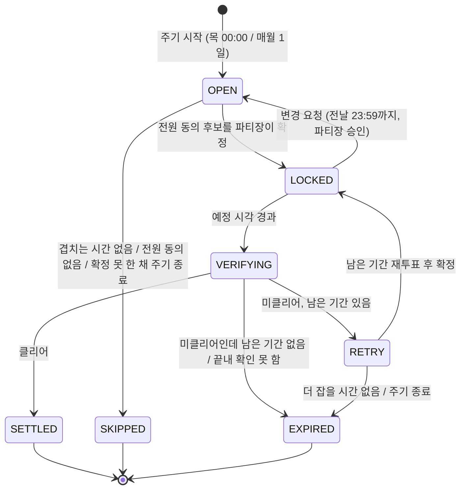
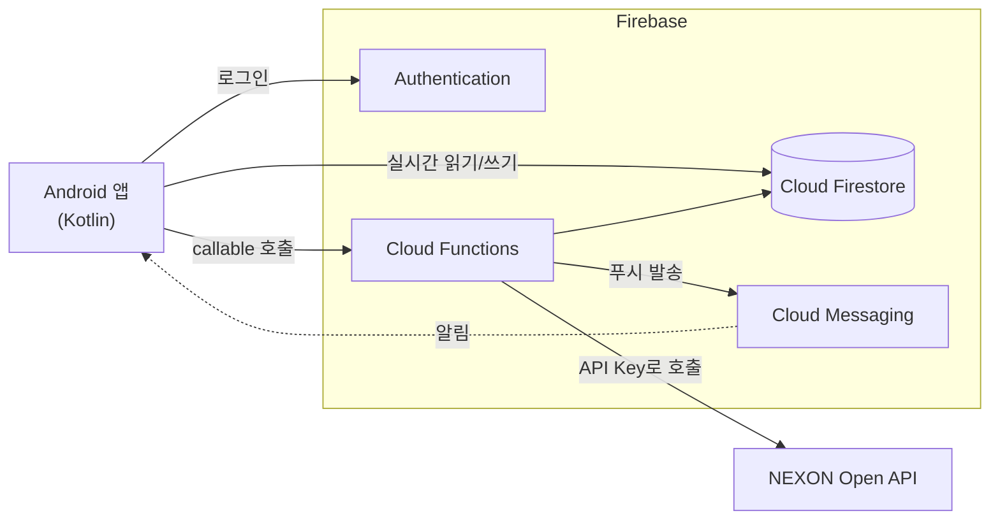

# 보스 스케줄 매니저

> 메이플스토리 고정 파티의 주간 보스 일정 조율부터 클리어 확인, 분배금 정산까지 한 앱에서 처리하는 Android 애플리케이션


파티를 한 번 등록해 두면, 파티원이 매주 할 일은 **불가능한 시간 체크와 투표**뿐입니다.

최신 APK는 [릴리스 페이지](https://github.com/JHK0826/boss_planner/releases/latest)에서 받을 수 있고, 버전별 변경 내용은 [CHANGELOG.md](CHANGELOG.md)에 있습니다.

---

## 목차

- [배경](#배경)
- [주요 기능](#주요-기능)
- [동작 흐름](#동작-흐름)
- [시스템 구조](#시스템-구조)
- [기술 스택](#기술-스택)
- [NEXON Open API 사용](#nexon-open-api-사용)
- [핵심 규칙](#핵심-규칙)
- [데이터 구조](#데이터-구조)
- [Cloud Functions](#cloud-functions)
- [보안](#보안)
- [개발 현황](#개발-현황)
- [시작하기](#시작하기)
- [버전 관리](#버전-관리)
- [출처](#출처)

---

## 배경

메이플스토리의 주간 보스는 매주 목요일 00:00에 초기화됩니다. 같은 멤버로 매주 보스를 잡는 **고정 파티**는 그때마다 서로 가능한 시간을 다시 맞춰야 합니다.

지금은 이 조율을 이렇게 합니다.

| 방식 | 문제 |
| --- | --- |
| 단톡방에서 가능 시간 수기 비교 | 답을 모아 사람이 하나씩 비교해야 하고, 변경 사항을 찾으려면 대화를 거슬러 올라가야 함 |
| 공유 엑셀 시간표 + 수식 | 입력 형식이 다르거나 수식이 깨지면 잘못된 시간이 나옴 |
| 파티별로 따로 조율 | 한 사람이 여러 파티에 속해 있어 파티끼리 시간이 겹침 |

보스 스케줄 매니저는 여러 파티의 일정을 **충돌 없이** 한곳에서 조율하고, 클리어 확인과 분배금 정산까지 이어 줍니다.

## 주요 기능

- **보스 묶음 파티:** 한 파티에 여러 보스를 묶어 한 번에 일정 조율 (예: 하드 발드릭스 + 하드 벨로나)
- **불가 시간 체크:** 30분 단위 시간표에 안 되는 시간을 표시하고 **제출** (안 되는 시간이 없어도 제출). 범위로 한 번에 채우기, 매주 반복되는 고정 불가 시간, 내 다른 파티에 함께 제출을 지원
- **추천 시간 계산:** 파티원 전원이 가능한 시각을 요일별로 최대 6개 추천. 파티 선호 시간대와 내 다른 레이드 앞뒤를 우선하고, 다른 파티에서 확정된 시간은 불가 시간과 똑같이 제외
- **그 주 미사용:** 전원이 겹치는 시간이 없으면 그 주기는 건너뜀(용병 사용 등)
- **동의 투표와 확정:** 전원이 동의한 후보 중에서 파티장이 최종 확정
- **파티 간 충돌 방지:** 같은 사용자가 속한 다른 파티 일정과 겹치면 확정 거절
- **미입력 경고:** 미입력 파티원에게 입력 요청, 파티장에게 "미입력 파티원이 존재합니다" 알림
- **일정 변경 요청:** 확정 후에도 레이드 전날 23:59까지 요청 가능, 파티장 승인 시 재투표
- **클리어 확인:** 레이드가 시작된 뒤 앱이 결과를 물어 클리어·미클리어를 직접 기록, 기록이 없으면 NEXON 스케줄러 API로 자동 확인
- **재조정:** 미클리어 시 이전 불가 시간을 그대로 써서 남은 기간 안에서 다시 추천
- **분배금 정산:** 경매장 판매액과 수수료로 파티원 정산금 계산, 상세 비율 설정, 수령 방법 채팅(이미지 첨부), `대기 → 지급함 → 수령 확인` 상태 관리
- **푸시 알림:** 주기 시작, 추천, 확정, 변경 요청, 결과 기록, 정산 단계마다 알림

## 동작 흐름

9단계를 4개 Phase로 나눴습니다.

| Phase | 단계 | 내용 |
| --- | --- | --- |
| **1. 온보딩·파티 매핑** (처음 1회) | 1–4 | 로그인 → API Key 등록·캐릭터 불러오기 → 캐릭터 선택 → 고정 파티 개설·초대 |
| **2. 주간 가용성·잠금** (매주 목요일 / 월간 보스는 매월 1일) | 5–7 | 시작 알림 → 불가 시간 입력 → 추천·동의 투표 → 파티장 확정 |
| **3. 클리어 확인** | 8-1 | 레이드 시작 후 앱에서 클리어·미클리어 직접 기록, 기록이 없으면 매일 05:00 API 확인 |
| **4. 사후 처리** | 8-2, 9 | 미클리어 시 재조정, 클리어 시 분배금 정산 |

### 일정 상태

일정은 파티마다 주기(주간 또는 월간)에 하나씩 만들어지고, 아래 상태를 거칩니다.



| 상태 | 뜻 |
| --- | --- |
| `OPEN` | 불가 시간 입력, 추천, 투표를 받는 중 |
| `LOCKED` | 레이드 시간이 확정됨 |
| `VERIFYING` | 예정 시각이 지나 결과(클리어 여부)를 기다리는 중 |
| `SETTLED` | 클리어. 분배금 정산 단계 |
| `RETRY` | 미클리어라 남은 기간에서 다시 조율하는 중. 절차는 `OPEN`과 같음 |
| `SKIPPED` | 이번 주기는 진행하지 않음 (그 주 미사용) |
| `EXPIRED` | 클리어하지 못하고 주기가 끝남 |

레이드가 시작된 뒤에는 `LOCKED` 상태에서도 바로 결과를 기록할 수 있습니다. 이때는 `VERIFYING`을 거치지 않고 `SETTLED`, `RETRY`, `EXPIRED`로 넘어갑니다.

### 앱 화면

하단 메뉴 네 개로 나뉩니다.

| 메뉴 | 내용 |
| --- | --- |
| 내 캐릭터 | 보스에 참여하도록 골라 둔 캐릭터 보기, 다시 선택 |
| 파티 | 내 파티 목록, 파티 만들기, 초대 코드로 가입. 파티를 누르면 일정·투표·정산으로 들어감 |
| 시간표 | 고정 불가 시간 설정, 확정된 일정 목록, 이번 주(목~수) 시간표 |
| 설정 | API Key 다시 등록, 로그아웃, 앱 버전 |

## 시스템 구조



| 영역 | 담당 |
| --- | --- |
| **클라이언트** (Android 앱) | 로그인·API Key 입력, 파티 만들기·가입, 불가 시간 체크·투표, 일정 변경 요청·승인, 이번 주 시간표, 클리어 기록, 정산·채팅 |
| **서버** (Cloud Functions, 서버리스) | NEXON API 호출 대행, 파티 구성 검사, 추천 시간 계산, 일정 확정, 변경 요청 마감 검사, 05시 클리어 확인, 정산 상태 관리, 알림 발송 |
| **데이터** (Cloud Firestore) | 계정·캐릭터·파티, 불가 시간·투표·확정 일정, 클리어 기록, 분배금·정산 채팅, API 응답 캐시 |
| **외부 API** (NEXON Open API) | 캐릭터 목록·ocid, 캐릭터 기본 정보, 보스 클리어 여부 |

NEXON API는 Cloud Functions에서만 호출하며, API Key와 캐릭터 식별자(ocid)는 앱에 저장하지 않습니다.

## 기술 스택

| 영역 | 기술 | 쓰임 |
| --- | --- | --- |
| 앱 | Kotlin, Jetpack Compose, Android Studio | 화면과 입력 |
| 인증 | Firebase Authentication | 이메일 회원가입·로그인 |
| DB | Cloud Firestore | 실시간 동기화, 트랜잭션, 보안 규칙 |
| 서버 | Cloud Functions (TypeScript, Node.js 22) | callable 함수, 예약 실행, Firestore 트리거 |
| 파일 | Cloud Storage for Firebase | 정산 채팅 첨부 이미지 |
| 알림 | Firebase Cloud Messaging | 시작·미입력·확정·변경·정산 알림 |
| 외부 API | NEXON Open API | 캐릭터 정보, 보스 클리어 여부 |
| 배포 | GitHub 릴리스의 서명한 APK | 스토어 등록 없이 파티원에게 배포 |
| 릴리스 | GitHub Actions | 버전이 바뀌면 태그·릴리스 생성, APK 빌드·첨부 |

## NEXON Open API 사용

| 단계 | 엔드포인트 | 사용 값 | 호출 시점 |
| --- | --- | --- | --- |
| 2 | `GET /maplestory/v1/character/list` | 계정의 캐릭터 목록, ocid | API Key 등록 시, 30일이 지나면 갱신 |
| 3 | `GET /maplestory/v1/character/basic` | 레벨, 직업, 이미지 | 캐릭터 선택 시 (24시간 캐시) |
| 8-1 | `GET /maplestory/v1/scheduler/character-state` | `boss_contents[].complete_flag` | 직접 기록이 없을 때 매일 05:00 |

- 호스트 `https://open.api.nexon.com`, 인증 헤더 `x-nxopen-api-key`, GET · JSON
- 본인 계정의 캐릭터만 조회할 수 있으므로 **파티원마다 자기 API Key를 등록**합니다.
- 게임 데이터는 평균 약 15분 뒤에 반영됩니다. 자동 확인은 레이드가 끝나고 30분이 지난 일정만 조회합니다.
- 스케줄러 API의 `date`(KST `YYYY-MM-DD`)는 그 날짜 기준 상태를 돌려주며, **최근 약 7일**까지만 조회됩니다. 더 오래된 날짜나 미래 날짜는 `OPENAPI00004`(400)입니다.
- `boss_contents` 항목은 `content_name`(보스 이름), `difficulty`(`easy`·`normal`·`hard`·`chaos`·`extreme`), `cycle`(`bossDaily`·`bossWeekly`·`bossMonthly`), `complete_flag`(문자열 `"true"`·`"false"`)입니다. 파티의 보스 이름·난이도가 이 값과 같아야 자동 확인이 됩니다. 서버의 보스 목록은 이 응답에서 가져왔습니다(일간 보스와 시즌 보스 제외).
- 위 세 엔드포인트의 응답 형식은 실제 API Key로 호출해 확인했습니다(2026-11).
- 개발 단계 호출 한도는 하루 1,000건입니다. 응답을 Firestore에 캐시해 중복 호출을 줄입니다.
- 재시도는 429, 5xx, 점검 중 코드에만 지수 백오프로 합니다.

## 핵심 규칙

### 주기와 마감

| 보스 | 주기 시작 | 주기 끝 | 불가 시간 입력 마감 | 파티 구성 변경 가능일 |
| --- | --- | --- | --- | --- |
| 주간 보스 | 매주 목요일 00:00 | 수요일 23:59 | 목요일 23:59 | 목요일 |
| 월간 보스 | 매월 1일 00:00 | 말일 23:59 | 1일 23:59 | 매월 1일 |

모든 시각은 한국 시간(KST)이고, 날짜와 마감 검사는 기기 시계가 아니라 서버 시각으로 합니다.

### 파티와 보스

- 한 파티에 보스를 여러 개(최대 12개) 묶을 수 있습니다. 보스마다 난이도를 따로 고릅니다.
- 주간 보스와 월간 보스(검은 마법사)는 주기가 달라 한 파티에 섞을 수 없습니다. 주기는 고른 보스에 따라 서버가 정합니다.
- **같은 캐릭터는 같은 보스를 두 파티에서 잡을 수 없습니다.** 난이도가 달라도 같은 보스로 봅니다. 예를 들어 하드 발드릭스 + 벨로나 묶음 파티에 넣은 캐릭터로는 발드릭스나 벨로나가 들어간 파티를 또 만들거나 가입할 수 없습니다. 다른 캐릭터로는 가능합니다.
- 보스 목록은 서버(`functions/src/domain/bosses.ts`)가 갖고 있고 앱은 `getBossCatalog`로 받아 씁니다. 새 보스가 나오면 이 파일만 고쳐 Functions를 배포하면 되고, 앱은 다시 설치하지 않아도 됩니다.
- **시즌 보스는 솔로 전용이라 목록에 넣지 않습니다.**
- 파티 정원은 6명입니다.

### 소요 시간

- 보스 하나에 20분으로 계산해 묶은 보스 수만큼 자동으로 잡고, 10분 단위로 고칠 수 있습니다(20분~4시간).
- 불가 시간표와 파티 간 충돌 검사는 30분 칸 단위입니다. 추천 시간은 정각이나 30분에 시작하고, 끝나는 시각은 실제 소요 시간으로 잡습니다(40분이면 20:00~20:40). 충돌 검사에서는 그 시간이 걸친 30분 칸 전체(20:00~21:00)를 잡힌 것으로 봅니다.

### 파티 구성 변경

- 가입, 탈퇴, 파티장 위임은 **주기 시작일에만** 할 수 있습니다.
- 가입과 탈퇴는 그날 중에서도 **이번 주기 일정이 확정되기 전**에만 할 수 있습니다. 가입·탈퇴가 있으면 추천과 투표를 다시 진행합니다.
- 예외: 아직 첫 주기가 시작되지 않은 **새 파티**는 요일과 상관없이 가입·탈퇴·위임할 수 있습니다. 주기 시작일에 만든 파티는 바로 그 주기 일정이 열리고, 다른 날에 만든 파티는 다음 주기 시작 때 첫 일정이 열립니다.
- 파티장은 다른 파티원에게 위임한 뒤에 탈퇴할 수 있습니다. 마지막 한 명이 탈퇴하면 파티가 삭제됩니다.

### 불가 시간 입력

- 파티원은 불가 시간을 체크한 뒤 **제출** 버튼을 눌러야 입력한 것으로 봅니다. 안 되는 시간이 없어도 제출합니다.
- 입력 마감은 **주기 시작일 23:59**입니다.
- 한 칸씩 누르지 않아도 되도록 세 가지를 지원합니다.
  - **한 번에 채우기:** 요일(매일·평일·주말·요일별)과 시간대를 골라 그 범위를 통째로 불가 또는 가능으로 바꿉니다. 날짜를 누르면 하루 전체가, 왼쪽의 시각을 누르면 그 시각의 모든 날이 바뀝니다. 되는 시간이 더 적다면 "전체 불가"를 누른 뒤 되는 시간대만 비우는 편이 빠릅니다.
  - **고정 불가 시간:** 출근·수면처럼 매주 반복되는 시간을 시간표 메뉴에서 한 번 저장해 두면, 새 주기의 시간표가 그 값으로 미리 채워집니다. 달라진 부분만 고치고 제출하면 됩니다. 미리 채워질 뿐 자동으로 제출되지는 않습니다.
  - **내 다른 파티에도 제출:** 불가 시간은 캐릭터가 아니라 사람 기준이므로, 제출할 때 같은 주기에 입력을 받는 내 다른 파티에도 같은 시간으로 함께 제출합니다(체크를 풀 수 있음). 주기가 다른 파티(주간 ↔ 월간)와 이미 확정된 파티는 건너뜁니다.
- 마감이 지나도 제출하지 않은 파티원에게는 입력 요청을, 파티장에게는 미입력자 알림을 매일 00:00에 보냅니다. 고정 파티라 따로 연락할 수 있으므로 미입력자를 자동으로 제외하지는 않습니다. 마감 뒤에도 제출은 받습니다.

### 추천 시간

전원이 제출하면 서버가 후보를 계산합니다(`functions/src/domain/recommend.ts`).

**가능한 시각**

- 전원이 소요 시간 내내 비어 있는 시각만 후보가 됩니다. 정각이나 30분에 시작합니다.
- 파티원이 속한 **다른 파티의 확정 시간(`busy`)은 불가 시간과 똑같이** 먼저 제외합니다. 확정 트랜잭션의 충돌 검사는 그 뒤의 최종 방어선입니다.
- 이미 지난 시간과 **최소 여유 시간** 안쪽은 추천하지 않습니다. 추천을 계산하는 시점으로부터 정한 시간(기본 3시간) 안에 시작하는 시각이 여기에 해당합니다. 그러면 남는 시각이 없을 때(주기 막바지 등)에는 여유 시간 없이 다시 찾습니다.

**우선순위**

시각마다 점수를 매겨 높은 것부터 고릅니다. 영향이 큰 순서입니다.

| 조건 | 효과 |
| --- | --- |
| **파티 선호 시간대** 안에 온전히 들어감 | 가장 먼저 추천 |
| 파티원이 겹치는 **다른 파티가 투표 중인 후보**와 겹침 | 뒤로 미룸. 두 파티가 같은 시간을 추천받아 한쪽이 확정 때 거절당하는 일을 줄임 |
| 파티원의 **다른 확정 레이드 바로 앞이나 뒤** | 우선. 한 번 접속했을 때 몰아서 돌 수 있음 (붙는 파티원이 많을수록 더 우선) |
| 정각에 시작 | 30분에 시작하는 시각보다 우선 |
| 주기 앞쪽 날짜 | 조금 우선. 미클리어 때 다시 잡을 여유가 남음 |

선호 시간대나 다른 파티 후보는 순서만 바꿉니다. 그 밖의 시각밖에 없으면 그 시각도 추천됩니다.

**후보 고르기**

- **요일마다 가장 좋은 시각을 하나씩** 먼저 고르고, 자리가 남으면 요일마다 두 번째, 세 번째를 채워 **최대 6개**를 줍니다. 같은 날의 후보끼리는 시간이 겹치지 않습니다.
- 투표 화면에는 시간순으로, 요일별로 묶어 보여 줍니다.
- 누군가 불가 시간을 고쳐 다시 제출하거나 제출을 취소하면, 또는 파티장이 추천 설정을 바꾸면 추천과 투표는 처음부터 다시 진행합니다.
- 전원이 겹치는 시각이 하나도 없으면 그 주기는 **`SKIPPED`(그 주 미사용)**로 끝냅니다.

**추천 설정**

파티마다 두 가지를 정합니다. 파티를 만들 때 정하고, 파티장이 파티 화면에서 바꿀 수 있습니다.

- **선호 시간대:** 요일(매일·평일·주말·요일별)과 시간 범위. 예: 매일 21:00~24:00. 정하지 않아도 됩니다.
- **최소 여유 시간:** 없음, 1·3·6·12·24시간 중 하나. 기본 3시간.

### 투표와 확정

- 파티원은 추천 후보마다 동의 여부를 투표합니다. 자기 투표만 쓸 수 있고 다른 사람의 투표는 바꿀 수 없습니다.
- 전원이 투표했는데 전원이 동의한 후보가 없으면 **다음 후보**로 넘어갑니다. 이미 보여 준 시각은 다시 나오지 않습니다. 더 줄 후보가 없으면 `SKIPPED`로 끝냅니다.
- 전원이 동의한 후보 중에서 파티장이 최종 확정합니다. 이미 지난 시간은 확정할 수 없습니다.
- 확정하는 순간 파티원 전원의 다른 파티 확정 시간과 겹치는지 다시 검사하고, 겹치면 누구의 일정과 겹치는지 알려 주며 거절합니다.

### 일정 변경 요청

- 확정(`LOCKED`) 후에도 **레이드 전날 23:59까지** 변경을 요청할 수 있습니다.
- 파티장이 승인하면 확정 시간을 해제하고 `OPEN`으로 돌아가 남은 기간 안에서 재투표합니다. 승인은 레이드 시작 전까지 할 수 있습니다. 파티장은 거절할 수도 있습니다.
- 승인되면 **요청한 사람은 불가 시간을 다시 제출**해야 새 추천이 나옵니다. 그대로 두면 같은 시간이 다시 추천되기 때문입니다.
- 처리 대기 중인 요청은 일정마다 하나만 둘 수 있습니다.

### 클리어 확인

메이플스토리 보스는 파티 단위로 클리어되므로 결과는 클리어 / 미클리어 두 가지뿐입니다. 묶음 파티는 **묶은 보스를 모두 클리어해야 클리어**입니다.

**직접 기록**

- 레이드 시작 시각이 지나면 앱이 파티원에게 결과를 묻고, **클리어 또는 미클리어**를 직접 기록하게 합니다. 시작 전에는 기록할 수 없습니다.
- 파티원 누구든 먼저 남긴 기록이 바로 반영되고, 되돌릴 수 없습니다.

**자동 확인**

- 기록이 없으면 매일 05:00에 스케줄러 API로 확인합니다. 이때 `date`는 **레이드 날짜**로 지정합니다(목요일 초기화 이후에도 수요일 레이드를 올바르게 확인하기 위함).
- 파티원들의 API Key로 차례로 조회해 **한 명이라도 클리어로 나오면 클리어**, 확인된 사람이 모두 미클리어면 미클리어로 봅니다.
- 키 만료나 점검으로 아무도 확인하지 못하면 `VERIFYING`에 두고 다음 날 다시 확인하며, 주기가 끝나고 이틀이 지나도 확인하지 못하면 `EXPIRED`로 끝냅니다.

**결과 처리**

- 클리어면 `SETTLED`가 되어 분배금 정산으로 넘어갑니다.
- 미클리어면 `RETRY`가 됩니다. 확정 시간을 풀고, 이전 불가 시간으로 남은 기간 안에서 바로 다시 추천합니다. 파티원은 불가 시간을 고쳐서 다시 제출할 수 있습니다. 이후 투표와 확정 절차는 처음과 같습니다.
- 미클리어인데 남은 기간이 없으면(예: 수요일 밤 레이드) `RETRY`를 거치지 않고 `EXPIRED`가 됩니다. `RETRY`에서 더 잡을 수 있는 시간이 없을 때도 `EXPIRED`로 끝냅니다.
- 일정을 확정하지 못한 채 주기가 끝나면 `OPEN`은 `SKIPPED`로, `RETRY`는 `EXPIRED`로 끝냅니다.

### 분배금 정산

**계산**

메이플스토리에서는 메소를 그냥 건넬 수 없어 경매장을 거칩니다. 판매자가 드롭 아이템을 팔아 실수령액을 받고, 받을 파티원이 경매장에 아무 물건이나 **정산금** 가격으로 올리면 판매자가 그것을 삽니다. 파티원은 정산금에서 수수료를 한 번 더 뗀 금액을 실제로 받습니다.

- 판매자가 **경매장 판매액**을 넣고 **수수료(5% 또는 3%)**를 고르면 실수령액(`판매액 × (1 − 수수료)`)이 나옵니다. 판매 금액은 NEXON API에 없으므로 직접 입력합니다.
- 정산금은 수수료를 뗀 뒤 받는 금액이 판매자 몫과 같아지도록 수수료를 얹어 계산합니다.

  ```text
  정산금 = 실수령액 ÷ ((1 − 수수료) + 받는 인원)
  ```

  예: 판매액 1억, 수수료 3%, 2명이면 실수령액 9,700만, 정산금은 9,700만 ÷ 1.97 = 49,238,500메소입니다. 파티원이 이 가격으로 올려 3%를 떼면 47,761,345메소를 받고, 판매자에게는 47,761,500메소가 남습니다.
- 정산금은 **100메소 단위로 내리고**, 내림으로 생긴 차이는 판매자가 갖습니다.
- 인원은 그 레이드에 참여한 파티원으로 고정입니다. 화면에는 받을 파티원의 정산금만 보여 줍니다.
- **상세 비율 설정**을 켜면 사람마다 비율(1~100)을 줄 수 있고, 닉네임별 정산금이 따로 나옵니다. 비율은 수수료를 뗀 뒤 실제로 받는 금액 기준입니다.

  ```text
  정산금_i = 실수령액 × 비율_i ÷ (판매자 비율 × (1 − 수수료) + 나머지 파티원 비율의 합)
  ```
- 금액은 서버가 계산합니다(`functions/src/settlement/calc.ts`). 앱은 등록 전에 같은 식으로 미리 보여 줄 뿐입니다.

**진행**

- 한 일정에는 **판매자 1명, 판매 1건**만 담습니다.
- 클리어한 일정(`SETTLED`)에서 **먼저 등록한 파티원이 판매자**가 됩니다. 판매자는 아무에게도 지급하기 전까지 고쳐서 다시 등록할 수 있습니다.
- 받을 파티원은 채팅으로 수령 방법을 전달합니다. 채팅에는 이미지를 첨부할 수 있습니다(5MB 이하, 앱이 올리기 전에 줄입니다).
- 판매자 `지급함` → 받은 사람 `수령 확인`, 전원 수령 확인 시 정산 완료. 상태는 이 순서로만 바뀌며, 판매자가 `지급함`으로 표시하기 전에는 수령을 확인할 수 없습니다.
- 다음 주기가 시작된 뒤에도 끝나지 않은 지난 주기 정산은 파티 화면에서 계속 열 수 있습니다(최근 4개 주기).

### 알림

| 때 | 받는 사람 |
| --- | --- |
| 주기 시작 | 전원 |
| 입력 마감이 지났는데 미입력 (매일 00:00) | 미입력 파티원에게 입력 요청, 파티장에게 "미입력 파티원이 존재합니다" |
| 추천 시간이 나옴, 다음 후보로 넘어감 | 전원 |
| 전원이 동의한 후보가 생김 | 파티장 |
| 일정 확정 | 전원 |
| 변경 요청 / 승인 / 거절 | 파티장 / 전원 / 요청한 사람 |
| 예정 시각이 지나 결과 기록 필요 | 전원 |
| 클리어, 미클리어 재조정, 미사용·만료 | 전원 |
| 분배금 등록 | 받을 파티원 |
| 지급함 / 수령 확인 | 받는 사람 / 판매자 |
| 정산 완료 | 전원 |
| 정산 채팅 메시지 | 보낸 사람을 뺀 전원 |

알림을 누르면 해당 파티 화면이 열립니다. 로그아웃하면 그 기기의 토큰을 지워 알림이 가지 않습니다.

## 데이터 구조

```text
users/{uid}                      프로필, 선택한 캐릭터, API Key 등록 여부
  characters/{characterId}       캐릭터 기본 정보 캐시 (레벨, 직업, 이미지 / ocid 없음)
  devices/{token}                FCM 토큰이 문서 ID (본인만 접근)
  private/routine                고정 불가 시간: 요일-시각 칸 목록 (본인만 접근)
  busy/{slotId}                  확정된 레이드 시간, 30분 칸마다 한 문서 (파티 간 충돌 검사, 내 확정 일정 표시)
secrets/{uid}                    API Key, ocid  ← 앱 접근 차단, Functions만 읽음
parties/{partyId}                보스 목록(이름·난이도), 주기, 소요 시간(분), 추천 설정(선호 시간대, 최소 여유 시간), 파티장, 파티원 uid 목록·캐릭터, 6자리 초대 코드
  schedules/{periodId}           상태, 추천 후보, 후보 라운드, 전원 동의 후보, 확정 시각, 변경 요청, 분배금 요약
    unavailable/{uid}            파티원별 불가 시간 (30분 칸), 제출 여부
    votes/{uid}                  파티원별 동의 투표 (본인만 쓰기)
    clears/{uid}                 직접 기록한 클리어·미클리어
    settlement/{uid}             받을 사람별 정산금, 대기·지급함·수령 확인 상태
    messages/{messageId}         정산 채팅 (글, 첨부 이미지 주소)
inviteCodes/{code}               초대 코드 → 파티 ID  ← 앱 접근 차단, joinParty만 읽음
```

정산 채팅에 첨부한 이미지는 Cloud Storage의 `parties/{partyId}/schedules/{periodId}/chat/{uid}/{파일}`에 저장합니다.

**확정 트랜잭션:** 파티장이 확정하면 하나의 트랜잭션 안에서 ① 일정이 아직 `OPEN`(또는 `RETRY`)인지, ② 그 후보에 전원이 동의했는지, ③ 파티원 전원의 `busy` 문서에 겹치는 시간이 없는지 확인한 뒤 `LOCKED`로 바꾸고 `busy`에 시간을 기록합니다. 같은 사용자가 속한 두 파티가 동시에 확정하면 나중 트랜잭션이 재실행되어 충돌로 거절됩니다. 충돌 단위는 캐릭터가 아니라 **사용자(uid)**입니다. `busy`의 `slotId`는 30분 칸마다 고정된 값(예: `20261112-2030`)이라, 같은 칸을 두 번 만들려는 시도가 문서 단위로 걸립니다.

**주기 ID와 시간 칸:** `periodId`는 주간이 `W-20261112`(시작 목요일), 월간이 `M-202611`입니다. 시간 칸 ID는 KST 기준 `yyyyMMdd-HHmm`(30분 단위)이고 `unavailable`의 `slots`와 `busy`의 문서 ID에 같이 씁니다.

**투표 라운드:** 일정의 `round`는 후보가 바뀔 때마다 1씩 오르고, 투표 문서는 자기가 투표한 `round`를 함께 저장합니다. 지난 라운드의 투표는 세지 않습니다.

**캐릭터 ID:** 앱은 캐릭터를 ocid 대신 ocid의 해시(`characterId`)로 가리킵니다. ocid는 `secrets/{uid}`에만 있습니다.

## Cloud Functions

모든 함수는 `asia-northeast3`(서울)에서 실행하고, 예약 함수는 `timeZone: "Asia/Seoul"`을 씁니다.

**callable** (앱이 직접 호출)

| 함수 | 역할 |
| --- | --- |
| `registerApiKey` | 키 유효성 확인, `secrets`에 저장, 캐릭터 목록 반환 |
| `listCharacters` | 저장된 캐릭터 목록 반환, 30일이 지났으면 다시 받아 옴 |
| `getCharacterInfo` | 캐릭터 기본 정보 조회·캐시 |
| `getBossCatalog` | 파티로 갈 수 있는 보스 목록과 소요 시간 기준 |
| `createParty` | 파티 개설(보스 묶음, 같은 캐릭터의 보스 중복 검사), 6자리 초대 코드 발급 |
| `joinParty` | 초대 코드로 가입 (주기 시작일 제한, 같은 캐릭터의 보스 중복 검사) |
| `leaveParty` / `delegateLeader` | 탈퇴, 파티장 위임 (주기 시작일 제한) |
| `updatePartyPreferences` | 파티장이 추천 설정(선호 시간대, 최소 여유 시간) 변경. 조율 중이면 후보를 다시 계산 |
| `confirmSchedule` | 파티장 확정, 파티 간 충돌 검사 트랜잭션 |
| `requestChange` / `approveChange` | 변경 요청(전날 23:59 마감 검사), 파티장의 승인·거절 |
| `registerSettlement` / `markPaid` / `confirmReceived` | 분배금 계산·등록(판매액, 수수료, 비율), 지급함, 수령 확인. 전원이 확인하면 정산 완료 처리 |

**trigger** (Firestore 문서가 바뀌면 실행)

| 함수 | 역할 |
| --- | --- |
| `onUnavailableWrite` | 전원 제출 시 추천 후보 계산, 겹치는 시간이 없으면 `SKIPPED` |
| `onVoteWrite` | 전원 동의 후보 갱신, 전원이 투표했는데 동의가 없으면 다음 후보 또는 `SKIPPED` |
| `onClearWrite` | 직접 기록한 클리어·미클리어 반영 (`SETTLED` / `RETRY` / `EXPIRED`) |
| `onScheduleStateChange` | 시작·추천·확정·변경·클리어·재조정·분배금 등록·정산 완료 알림 |
| `onSettlementWrite` | 지급·수령 알림 |
| `onMessageCreate` | 정산 채팅 알림 |

**scheduled** (정해진 시각에 실행)

| 함수 | 시각 | 역할 |
| --- | --- | --- |
| `weeklyOpen` | 목요일 00:00 | 지난 주기 정리, 주간 보스 파티의 새 주기 일정 생성 |
| `monthlyOpen` | 매월 1일 00:00 | 지난 주기 정리, 월간 보스 파티의 새 주기 일정 생성 |
| `scheduleSweep` | 30분마다 | 예정 시각이 지난 일정을 `VERIFYING`으로, 주기가 끝난 미확정 일정을 종료로 |
| `dailyClearCheck` | 매일 05:00 | 기록 없는 일정의 클리어 확인, 30일 지난 캐릭터 목록 갱신 |
| `inputDeadlineCheck` | 매일 00:00 | 입력 마감이 지난 일정의 미입력 경고 |

주기 시작 알림은 `weeklyOpen`·`monthlyOpen`이 일정 문서를 만들 때 `onScheduleStateChange`가 보냅니다.

## 보안

- API Key와 ocid는 `secrets` 컬렉션에만 저장하고, Firestore 보안 규칙으로 클라이언트 접근을 막습니다.
- NEXON API 호출은 Cloud Functions에서만 합니다. 키와 ocid를 로그·URL·화면에 남기지 않습니다.
- 파티·일정 문서는 해당 파티원만 읽을 수 있습니다. 파티 구성, 일정 상태, 추천 후보, 확정 시각, 정산 상태는 Cloud Functions만 씁니다.
- 클라이언트가 직접 쓰는 것은 자기 프로필, 자기 기기 토큰, 자기 고정 불가 시간, 자기 불가 시간, 자기 투표, 자기 클리어 기록, 채팅뿐입니다.
- 클리어 기록은 확정된 레이드가 시작된 뒤에만 쓸 수 있습니다.
- 채팅 이미지는 파티원만 읽을 수 있고, 자기 폴더에 이미지 파일(5MB 미만)만 올릴 수 있습니다. 올린 뒤에는 고치거나 지울 수 없습니다. 채팅 메시지의 이미지 주소는 Firebase Storage 주소만 받습니다.
- 초대 코드 문서는 앱에서 읽을 수 없어 코드를 훑어볼 수 없습니다.
- 마감 시각, 요일 제한, 파티장 권한 같은 검사는 서버에서 서버 시각으로 합니다.

## 개발 현황

현재 버전은 [CHANGELOG.md](CHANGELOG.md)를 참고하세요. 설계한 네 Phase의 코드가 모두 들어 있습니다.

| 주차 | Phase | 내용 |
| --- | --- | --- |
| 1주차 | 기반 구축 | Firebase 연결, 로그인, API Key 등록, 캐릭터 불러오기·선택 |
| 2주차 | 파티와 투표 | 고정 파티 개설·초대, 불가 시간 체크, 추천 시간 계산, 투표 |
| 3주차 | 확정과 확인 | 일정 확정, 변경 요청, 스케줄러 API 확인, 05시 예약 실행, `RETRY` 재조정 |
| 4주차 | 정산과 마무리 | 분배금 등록·채팅, 지급·수령 확인, FCM 알림, APK 빌드 |

**확인한 것**

- 서버 로직: 단위 테스트와 Firestore 에뮬레이터 테스트
- NEXON API 클라이언트: 실제 API Key로 호출
- 앱: 빌드와 lint
- 릴리스: GitHub Actions로 태그·릴리스 생성, 서명한 APK 첨부
- 실제 Firebase 프로젝트 배포 후 기기에서 가입, API Key 등록, 캐릭터 선택, 파티 만들기

**아직 확인하지 못한 것**

- [ ] 일정 주기 전체: 불가 시간 입력 → 추천 → 투표 → 확정 → 클리어 기록 → 정산
- [ ] 여러 명이 있는 파티에서의 동작 (가입, 전원 동의, 파티 간 충돌)
- [ ] 예약 함수(주기 시작, 05시 클리어 확인)와 푸시 알림

## 시작하기

### 앱 설치 (파티원)

서버가 이미 배포되어 있다면 파티원은 APK만 설치하면 됩니다.

1. [릴리스 페이지](https://github.com/JHK0826/boss_planner/releases/latest)에서 `boss-planner-<버전>-release.apk`를 받아 설치합니다. 기기에서 "출처를 알 수 없는 앱 설치"를 허용해야 합니다.
2. 이메일로 가입합니다.
3. [NEXON Open API](https://openapi.nexon.com)에서 메이플스토리 API Key를 발급받아 앱에 등록합니다.
4. 보스에 참여할 캐릭터를 고릅니다.
5. 파티를 만들거나, 파티장에게 받은 6자리 초대 코드로 가입합니다.

새 버전이 나오면 같은 페이지에서 새 APK를 받아 그대로 설치하면 기존 앱 위에 덮어 설치됩니다.

### 서버와 앱 직접 준비 (개발)

**요구 사항**

- Android Studio (최신 안정 버전), JDK 17
- Node.js 22 (Firebase CLI는 `functions`의 개발 의존성에 포함)
- Firebase 프로젝트 (Cloud Functions 사용을 위해 Blaze 요금제)
- [NEXON Open API](https://openapi.nexon.com) API Key

**설정**

1. 저장소를 클론합니다.
   ```bash
   git clone https://github.com/JHK0826/boss_planner.git
   cd boss_planner
   ```
2. Firebase 콘솔에서 Android 앱을 등록합니다. 패키지 이름은 `com.bossplanner.app`이어야 합니다. 내려받은 `google-services.json`을 `app/`에 넣습니다.
3. Authentication의 이메일/비밀번호 로그인을 켜고 Firestore 데이터베이스를 만듭니다. Firestore 위치는 Functions와 같은 `asia-northeast3`(서울)이어야 트리거가 붙습니다. 채팅 이미지를 쓰려면 Storage도 "시작하기"로 켭니다.
4. Functions와 보안 규칙, 인덱스를 배포합니다.
   ```bash
   cd functions
   npm install
   npx firebase login
   npx firebase deploy --project <프로젝트 ID> --only functions,firestore,storage
   ```
   Storage 규칙이 Firestore의 파티원 목록을 읽기 때문에, 처음 배포할 때 권한을 줄지 묻습니다. `Y`로 답합니다.
   첫 배포는 필요한 Google Cloud API를 켜느라 몇 분 걸립니다. 권한이 아직 적용되지 않았다는 오류로 실패하면 몇 분 뒤 같은 명령을 다시 실행합니다.
5. Android Studio에서 저장소 최상위 폴더를 열어 앱을 실행하고, 앱 안에서 본인의 NEXON API Key를 등록합니다.

> `google-services.json`, 서명 키 저장소, API Key는 저장소에 커밋하지 마세요.

### APK 직접 빌드

```bash
./gradlew assembleDebug
```

`app/build/outputs/apk/debug/boss-planner-<버전>-debug.apk`가 만들어집니다. 개발 중 시험용입니다. 디버그 키로 서명되어 릴리스 APK와 서명이 다르므로 서로 덮어 설치되지 않습니다. 파티원에게 배포할 APK는 [버전 관리](#버전-관리)의 절차로 만든 릴리스 APK를 쓰세요.

### 폴더 구조

```text
app/                    Android 앱 (Kotlin, Jetpack Compose)
functions/              Cloud Functions (TypeScript)
  src/nexon/            NEXON Open API 클라이언트 (재시도, 에러 분류)
  src/domain/           주기·시간 칸 계산, 추천 알고리즘, 보스 목록 (순수 함수)
  src/party/            파티 개설·가입·탈퇴·위임
  src/schedule/         일정 생성, 추천·투표 판정, 확정, 변경 요청, 클리어 확인, 상태 정리
  src/settlement/       분배금 계산·등록, 지급·수령 확인
  src/notify/           알림 문구 규칙 (순수 함수), FCM 발송
  src/callable/         callable 함수
  src/triggers.ts       Firestore 트리거, 예약 함수
  test/unit/            단위 테스트
  test/rules/           Firestore·Storage 보안 규칙 테스트 (에뮬레이터)
  test/emulator/        파티·일정·정산·알림 통합 테스트 (에뮬레이터)
firebase.json           Firebase 배포·에뮬레이터 설정
firestore.rules         Firestore 보안 규칙
firestore.indexes.json  Firestore 인덱스
storage.rules           Cloud Storage 보안 규칙 (채팅 이미지)
version.properties      앱 버전 (versionName, versionCode)
CHANGELOG.md            버전별 변경 기록
scripts/                릴리스 노트 추출 스크립트
.github/workflows/      버전이 바뀌면 태그와 릴리스를 만드는 워크플로
```

### 테스트

```bash
cd functions
npm test               # 단위 테스트
npm run test:emulator  # 보안 규칙·통합 테스트 (Firestore·Storage 에뮬레이터, Java 필요)
```

앱의 분배금 계산은 서버와 같은 금액이 나오는지 따로 테스트합니다.

```bash
./gradlew :app:testDebugUnitTest
```

## 버전 관리

버전별 변경 내용은 [CHANGELOG.md](CHANGELOG.md)에, 버전별 APK는 [릴리스 페이지](https://github.com/JHK0826/boss_planner/releases)에 있습니다. 앱의 설정 메뉴에도 설치된 버전이 표시됩니다.

### 번호 규칙

`MAJOR.MINOR.PATCH` 형식입니다.

| 자리 | 올리는 때 | 예 |
| --- | --- | --- |
| PATCH | 버그 수정, 문구·화면 다듬기 | 0.1.0 → 0.1.1 |
| MINOR | 기능 추가. 이전 앱도 계속 쓸 수 있음 | 0.1.1 → 0.2.0 |
| MAJOR | 이전 앱이 새 서버와 맞지 않게 되는 변경. 파티원 전원이 앱을 다시 설치해야 함 | 0.2.0 → 1.0.0 |

### 패치를 올리는 순서

1. [version.properties](version.properties)에서 `versionName`을 규칙대로 올리고 `versionCode`를 1 올립니다. `versionCode`가 커져야 기존 앱 위에 덮어 설치됩니다.
2. [CHANGELOG.md](CHANGELOG.md) 맨 위에 `## <버전> - <날짜>` 항목을 추가하고 바뀐 내용, 서버 배포가 필요한지, 이전 앱과 호환되는지를 적습니다. 이 항목이 없으면 릴리스 작업이 실패합니다.
3. 코드 변경과 함께 PR로 올려 `main`에 병합합니다.
4. 병합되면 GitHub Actions가 `v<버전>` 태그와 GitHub 릴리스를 자동으로 만들고, 서명한 APK를 빌드해 붙입니다. 릴리스 노트는 CHANGELOG의 해당 항목입니다.
5. 서버 변경이 있으면 Functions를 배포합니다. 파티원은 릴리스 페이지에서 APK를 받아 설치합니다.

`version.properties`를 고치지 않은 병합은 릴리스를 만들지 않습니다. 문서만 고친 경우처럼 버전을 올릴 필요가 없는 변경은 그대로 병합하면 됩니다.

### 릴리스에 APK 자동 첨부

저장소의 **Settings → Secrets and variables → Actions → New repository secret**에 아래 값을 등록해 두면, 릴리스를 만들 때 서명한 APK(`boss-planner-<버전>-release.apk`)를 빌드해 함께 올립니다. 등록하지 않으면 APK 없이 릴리스만 만들어집니다.

| 이름 | 값 |
| --- | --- |
| `GOOGLE_SERVICES_JSON` | `google-services.json` 파일의 내용 전체 |
| `KEYSTORE_BASE64` | 서명 키 저장소 파일을 base64로 바꾼 글자 |
| `KEYSTORE_PASSWORD` | 키 저장소 비밀번호 |
| `KEY_ALIAS` (선택) | 키 별칭. 등록하지 않으면 `bossplanner` |
| `KEY_PASSWORD` (선택) | 키 비밀번호. 등록하지 않으면 키 저장소 비밀번호와 같다고 봅니다 |

서명 키 저장소는 한 번만 만듭니다. `keytool`은 Android Studio에 들어 있습니다. 비밀번호(6자 이상)만 두 번 묻습니다.

```bash
keytool -genkeypair -keystore boss-planner.keystore -alias bossplanner -keyalg RSA -keysize 2048 -validity 10000 -dname "CN=Boss Planner"
```

만든 파일을 base64 글자로 바꿔 클립보드에 복사합니다.

```bash
# Windows (PowerShell)
[Convert]::ToBase64String([IO.File]::ReadAllBytes("boss-planner.keystore")) | Set-Clipboard

# Mac
base64 -i boss-planner.keystore | pbcopy
```

> 서명 키 저장소 파일과 비밀번호는 저장소 밖의 안전한 곳에 따로 보관하세요. 잃어버리면 같은 서명으로 빌드할 수 없어서, 파티원이 기존 앱을 지우고 새로 설치해야 합니다. 이 파일은 커밋하지 마세요(`.gitignore`에 들어 있습니다).

릴리스의 APK는 릴리스 키로 서명되고, 컴퓨터에서 `assembleDebug`로 만든 APK는 디버그 키로 서명됩니다. 서명이 다르면 서로 덮어 설치되지 않으므로, 파티원에게는 릴리스 페이지의 APK만 배포하세요.

## 출처

Data based on NEXON Open API.

이 프로젝트는 넥슨과 무관한 개인 학습용 프로젝트이며, 메이플스토리 관련 명칭과 데이터의 권리는 NEXON Korea에 있습니다.
